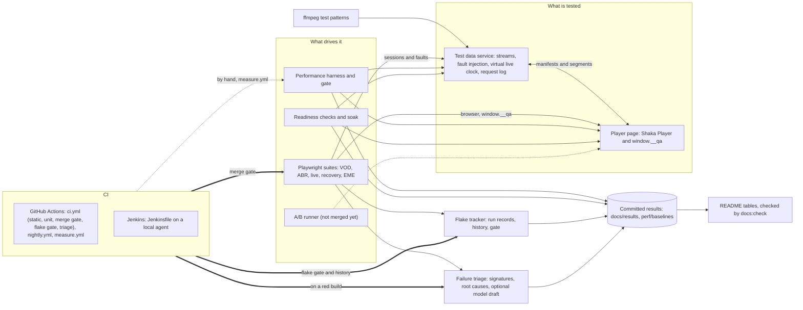

# Playback Proof

Playback Proof is a test lab for a web video player (Shaka Player on Media Source Extensions). It generates its own streams, injects network faults on purpose and plays the result in Chromium, Firefox and WebKit, so that startup, adaptation, recovery and live behaviour can be tested, measured and gated on a merge. Every number below is rendered from a result file committed in this repository, counted by a command that the text names, or taken from a document or a CI run that the text cites.

Stack: TypeScript (strict), Node.js 22, Shaka Player 5.3.3, Playwright 1.64.1, Vitest 5, ffmpeg.

The repository is public. It is a test lab on localhost with synthetic streams, not production monitoring: its numbers say nothing about a CDN, a real network or a hardware decoder (see [Limitations and honesty notes](#limitations-and-honesty-notes)).

## What this proves

The project makes three claims. Each row below is one clause of them, with what implements it, where the evidence is, and whether it is done. A clause that is only partly true says exactly how.

1. Defined the end-to-end test strategy for an open-source MSE web player across consumer web scenarios (VOD, live events); built a test data service for reproducible streams and Playwright suites for Chromium, Firefox and WebKit.
2. Ran the suites as merge gates in Jenkins and GitHub Actions; added A/B testing of player configurations on startup time and rebuffering, readiness checks for simulated live events, and AI-assisted failure triage that clusters CI failures by root cause.
3. Tracked flake rate and performance baselines (startup time, rebuffering, frame rate) on every build, failing merges on regressions.

| Claim | Implemented in | Evidence | Status |
| --- | --- | --- | --- |
| 1. A test strategy for an open-source MSE player across VOD and live scenarios | [`TEST_STRATEGY.md`](TEST_STRATEGY.md) (risk ranking, test catalog, gates, policy numbers), [`docs/decisions/strategy.md`](docs/decisions/strategy.md), [`tools/catalog.ts`](tools/catalog.ts), [`tools/check-specs.ts`](tools/check-specs.ts) | The catalog is checked against the specs, and the strategy's tables against the code, in the `static` job of every build ([CI run 41873901864](https://github.com/hanniavalera/playback-proof/actions/runs/41873901864)); [the suites](#the-suites) | Done |
| 1. A test data service for reproducible streams | [`src/server/`](src/server) (service), [`src/server/media/`](src/server/media) (ffmpeg generation, content-addressed cache), [`tools/generate-streams.ts`](tools/generate-streams.ts), [`tools/verify-streams.ts`](tools/verify-streams.ts) | One ffmpeg build gives identical bytes at any thread count ([ADR-045](docs/decisions/media.md)); [`tests/unit/media/specs.test.ts`](tests/unit/media/specs.test.ts) pins the cache key; every CI leg prints the content hash of the streams it plays ([`docs/CI.md`](docs/CI.md), "How the data moves") | Done, with a caveat: bytes are identical for one ffmpeg build only. CI generates with Ubuntu's ffmpeg 6.1, the development host runs 9.0.2, and the committed probe media differs between them ([codec matrix files](docs/results/codec-matrix)), so every environment has its own baselines |
| 1. Playwright suites for Chromium, Firefox and WebKit | [`tests/e2e/`](tests/e2e) (VOD, ABR, live, recovery, EME), [`playwright.config.ts`](playwright.config.ts), [`tests/e2e/support/`](tests/e2e/support) | [The suites](#the-suites); the five merge-gate legs are green on `main` ([CI run 41873901864](https://github.com/hanniavalera/playback-proof/actions/runs/41873901864)) | Done, with caveats: Linux WebKit is an experimental engine (a required check, flake-tracked); Firefox runs in CI and in Docker, not natively on the macOS development host; the EME test (ClearKey) is assigned to Chromium and Firefox; two ABR tests skip an attempt that cannot judge its claim, and the flake report counts those skips ([ADR-106](docs/decisions/e2e-abr.md)) |
| 2. Suites run as merge gates in GitHub Actions | [`.github/workflows/ci.yml`](.github/workflows/ci.yml), [`tools/gate-merge.ts`](tools/gate-merge.ts); branch protection on `main` requires `static`, `unit`, the five `merge-gate` legs and `flake` ([`TEST_STRATEGY.md`](TEST_STRATEGY.md) section 6.1) | [CI run 41873901864](https://github.com/hanniavalera/playback-proof/actions/runs/41873901864); [`docs/CI.md`](docs/CI.md) | Done |
| 2. Suites run as merge gates in Jenkins | [`Jenkinsfile`](Jenkinsfile), [`docker-compose.yml`](docker-compose.yml), [`jenkins/`](jenkins), [`tests/unit/ci/parity.test.ts`](tests/unit/ci/parity.test.ts) (the two pipelines may not drift apart) | [Jenkins builds](#jenkins): two green builds and one red on purpose, with the evidence of each | Done, with caveats: Jenkins runs as a local docker-compose, not as a hosted service; the committed builds predate the `Flake` and `Triage` stages |
| 2. A/B testing of player configurations on startup time and rebuffering | The two configurations under test ([`src/player/configs.ts`](src/player/configs.ts)) and the experiment policy ([`TEST_STRATEGY.md`](TEST_STRATEGY.md) section 12, ADR-027); the runner (`ab/`) is not on `main` yet | None committed: `docs/results/ab` does not exist | Not on `main` yet: no A/B result is claimed here |
| 2. Readiness checks for simulated live events | [`live/readiness.ts`](live/readiness.ts), [`live/soak.ts`](live/soak.ts), [`src/lab/readiness/`](src/lab/readiness), [`tests/live/readiness.spec.ts`](tests/live/readiness.spec.ts), the virtual live clock ([`src/server/liveclock.ts`](src/server/liveclock.ts)); [ADR-150 to ADR-159](docs/decisions/readiness.md) | Unit tests of the checks and of the soak harness ([`tests/unit/readiness/`](tests/unit/readiness)); no committed measurement yet (`docs/results/readiness`, `docs/results/soak`) | Built, not measured yet: the harness is merged, its results are not committed |
| 2. AI-assisted failure triage that clusters CI failures by root cause | [`triage/`](triage), [`src/lab/signature.ts`](src/lab/signature.ts), the `triage` job of [`ci.yml`](.github/workflows/ci.yml) and the `Triage` stage of the [`Jenkinsfile`](Jenkinsfile); [`docs/TRIAGE.md`](docs/TRIAGE.md) | [Failure triage](#failure-triage): seven induced failures read as one directory; [`tests/unit/triage/real-failures.test.ts`](tests/unit/triage/real-failures.test.ts) pins the clusters | Done, with a caveat: the clustering is deterministic code and needs no key; the optional model draft per cluster was verified against a local mock only, because no API key exists in the development environment |
| 3. Flake rate tracked on every build | [`flake/`](flake) (reporter, history, report, gate), the `flake` and `flake-record` jobs of [`ci.yml`](.github/workflows/ci.yml), the history on the orphan branch `ci-data`; [`docs/FLAKE.md`](docs/FLAKE.md) | A pull request is judged against the history and every build of `main` that is not cancelled is recorded in it (`flake` and `flake-record` in [CI run 41873901864](https://github.com/hanniavalera/playback-proof/actions/runs/41873901864); `git show origin/ci-data:history/gha-linux-x64.jsonl`) | Done, with a caveat: the flake rates collected so far are not committed as results yet (`docs/results/flake`) |
| 3. Performance baselines (startup time, rebuffering, frame rate) | [`perf/`](perf), [`src/lab/measure/`](src/lab/measure), [`perf/baselines/`](perf/baselines); [`docs/PERF.md`](docs/PERF.md) | [Performance](#performance): baselines, derived thresholds, A/A checks and sensitivity checks | Done, with a caveat: baselines exist for two environments, the development workstation and its Playwright container; the GitHub runners' baselines are not recorded yet |
| 3. ... on every build | `npm run gate:perf` ([`perf/gate.ts`](perf/gate.ts)) | Neither [`ci.yml`](.github/workflows/ci.yml) nor the [`Jenkinsfile`](Jenkinsfile) runs it | Not yet: performance is not measured on every build |
| 3. ... failing merges on regressions | The merge gate and the flake gate are required checks; `gate:perf` exits 1 when a regression reproduces | Jenkins build 6 turns red engine by engine on a deliberate regression ([Jenkins builds](#jenkins)); the sensitivity table shows what the performance gate does with injected regressions ([Performance](#performance)) | Done, with a caveat: a functional or flake regression fails the merge today; a performance regression fails `npm run gate:perf` but that gate is not a CI check yet, and a deliberately red pull request on GitHub has not been kept as a demonstration |

## Architecture



Solid arrows are what runs today. Dotted ones are not merged yet or not wired into CI yet. The Playwright suites, the performance harness and the readiness checks all drive the same player page through the same hook and configure the same service; the service gives every test a session of its own, so tests that run in parallel cannot disturb each other.

| Component | Path | What it does | Read |
| --- | --- | --- | --- |
| Test data service | [`src/server/`](src/server) | A `node:http` service: one isolated session per test, DASH and HLS manifests, segments, faults (throttle, latency, status, stall, abort, live stall, stale manifest), a virtual live clock over looped content, a request log | [`docs/CONTRACTS.md`](docs/CONTRACTS.md) sections 3 to 5, [decisions](docs/decisions/server.md) |
| Media pipeline | [`src/server/media/`](src/server/media) | ffmpeg test-pattern streams (VP9 video, AAC or Opus audio) as CMAF and WebM, DASH and HLS builders, the `tfdt` rewrite that loops live content, ClearKey encryption, a content-addressed cache | [decisions](docs/decisions/media.md) |
| Shared contracts | [`src/shared/`](src/shared) | Types of streams, faults, URLs and the `window.__qa` hook, and every policy number (`criteria.ts`) | [`docs/CONTRACTS.md`](docs/CONTRACTS.md) |
| Player page | [`src/player/`](src/player) | Shaka Player with the `window.__qa` hook: an event timeline with a cursor, metrics as pure functions of it, and configurations A (Shaka's defaults) and B (three overrides) | [`docs/METRICS.md`](docs/METRICS.md), [decisions](docs/decisions/player.md) |
| Lab libraries | [`src/lab/`](src/lab) | The codec probe, the performance measurement library, the readiness checks, the service client, the documented gaps | [codecs](docs/decisions/codecs.md), [perf](docs/decisions/perf.md), [readiness](docs/decisions/readiness.md) |
| Playwright suites | [`tests/e2e/`](tests/e2e), [`tests/live/`](tests/live) | The browser tests, written against the hook and the service's request log; no fixed sleeps (ESLint enforces it) | [`TEST_STRATEGY.md`](TEST_STRATEGY.md), [`docs/CONTRACTS.md`](docs/CONTRACTS.md) section 7 |
| Unit tests | [`tests/unit/`](tests/unit) | Vitest tests of the lab itself, including tests that run the real ffmpeg | [`TEST_STRATEGY.md`](TEST_STRATEGY.md) |
| Performance harness | [`perf/`](perf) | Baselines per environment, the gate, the A/A check and the threshold derivation | [`docs/PERF.md`](docs/PERF.md) |
| Readiness and soak | [`live/`](live) | The live-event checks and the long soak session | [decisions](docs/decisions/readiness.md) |
| Flake tracker | [`flake/`](flake) | Reporter, history, quarantine list, report and gate | [`docs/FLAKE.md`](docs/FLAKE.md) |
| Failure triage | [`triage/`](triage) | Signatures, root-cause rules, redaction, optional model drafts | [`docs/TRIAGE.md`](docs/TRIAGE.md) |
| CI | [`.github/workflows/`](.github/workflows), [`Jenkinsfile`](Jenkinsfile), [`jenkins/`](jenkins), [`docker-compose.yml`](docker-compose.yml) | The merge gate, the nightly release tier and the manual measurements on GitHub; the same gate stages on a local Jenkins | [`docs/CI.md`](docs/CI.md), [`jenkins/README.md`](jenkins/README.md) |
| Tools | [`tools/`](tools) | Stream generation and verification, the codec matrix, the documentation checks and the generator of the tables below | [`docs/README-TOOLING.md`](docs/README-TOOLING.md) |

## Quick start

**Prerequisites.**

- Node.js 22.13 or newer (`engines` in [`package.json`](package.json); CI installs the version in [`.nvmrc`](.nvmrc)).
- ffmpeg on the `PATH`, to generate the streams and for the media unit tests. CI uses Ubuntu's 6.1.1 (the `streams` job); the development host runs 9.0.2.
- Playwright's browsers: `npx playwright install chromium firefox webkit` (on Linux add `--with-deps`, which is what each CI leg does).
- Docker is optional: it runs Firefox on a macOS host, where Playwright's Firefox does not start, and reproduces the Linux environment (`npm run docker:pw`); it also runs the local Jenkins.

**The shortest sequence that shows something working, in order.**

```sh
npm ci                                       # the locked dependencies
npx playwright install chromium              # one browser is enough to start
npm run generate:streams                     # the lab's streams, once, into .cache/streams
npm run build:player                         # the player page, into dist/player
npm run gate:static                          # typecheck, lint, format, docs, specs, codec matrix freshness
npm run gate:merge -- --project=chromium     # the @merge Playwright tests in Chromium
```

| Step | What happens | Time | Verified by |
| --- | --- | --- | --- |
| `npm ci` | Installs the locked dependencies. | Not measured here. | The `setup` action of every CI job. |
| `npm run generate:streams` | Encodes the five streams with ffmpeg and prints their content hashes; a complete cache is a no-op. | 176 s with a cold cache on the Jenkins agent, 1 s with a warm one ([Jenkins builds](#jenkins), `Streams` stage of builds 3 and 4). | The `streams` job of CI. |
| `npm run build:player` | Writes `dist/player`; the service refuses to serve without it. | Under a second (0.4 s on the development host). | Every `merge-gate` leg runs it; run for this README. |
| `npm run gate:static` | Typecheck, lint, format check, docs check (this README's tables included), specs check, codec matrix freshness. | About 40 s in the `static` job. | The `static` job ([CI run 41873901864](https://github.com/hanniavalera/playback-proof/actions/runs/41873901864)); run for this README. |
| `npm run gate:merge -- --project=chromium` | Starts the service through Playwright's `webServer` and runs the merge-tier tests of that engine; the HTML report is `reports/html`, the JSON report `reports/playwright.json`. | About 1 min 43 s for the whole `merge-gate (chromium)` job. | The `merge-gate (chromium)` job of the same run. |

The unit suite is `npm run gate:unit` (Vitest; it runs the real ffmpeg, so ffmpeg must be installed): the `unit` job takes about 1 min 33 s on a GitHub runner. Firefox on a macOS host runs in the Playwright image: `npm run docker:pw -- npm run gate:merge -- --project=firefox` is the command [`docs/CI.md`](docs/CI.md) gives ("Reproducing a job locally"; not run for this README), and the committed `docker-linux-arm64` codec matrix was recorded through the same wrapper.

## How to run everything

Each row is a script of [`package.json`](package.json), or the tool behind it. Times are the ones the documents or the committed results give; where none is given the row says so. The commands that CI runs are the ones marked in the quick start; the others are quoted from the document in the last column, and were not run for this README.

| Area | Command | What it does | Time, and what it needs | Read |
| --- | --- | --- | --- | --- |
| Gates | `npm run gate:static` | Typecheck, lint, format, docs and specs checks, codec matrix freshness | About 40 s in CI | [`TEST_STRATEGY.md`](TEST_STRATEGY.md) section 6.1 |
| Gates | `npm run gate:unit`, `npm run test:unit` | The Vitest suite of the lab (`gate:unit` is the CI stage and runs `test:unit`) | About 1.5 min in CI; needs ffmpeg | [`docs/CI.md`](docs/CI.md) |
| Gates | `npm run gate:merge -- --project=<project>` | The `@merge` Playwright tests of one project (`chromium`, `firefox`, `chromium-cpu4x` or `webkit`); quarantined tests run apart, non-blocking | 1.5 to 3.5 min per leg in CI; needs the streams, the player build and the browser | [`docs/FLAKE.md`](docs/FLAKE.md) |
| Gates | `npm run gate:flake` | Judges this build's runs against the history of their environment and the quarantine list | Not measured | [`docs/FLAKE.md`](docs/FLAKE.md) |
| Gates | `npm run gate:perf` | The performance scenarios against the baseline of this environment; fails only when a regression reproduces | About 6 to 7 min for Chromium and its throttled profile on the workstation ([`TEST_STRATEGY.md`](TEST_STRATEGY.md) section 6.3); needs a quiet machine | [`docs/PERF.md`](docs/PERF.md) |
| Gates | `npm run gate:triage` | Clusters the failures of a red build; never decides a verdict | Not measured | [`docs/TRIAGE.md`](docs/TRIAGE.md) |
| Checks | `npm run typecheck`, `npm run lint`, `npm run format:check`, `npm run format` | TypeScript, ESLint (no fixed sleeps in specs), Prettier (`format` rewrites, `format:check` only checks) | Part of `gate:static` (all but `format`) | [`docs/CONTRACTS.md`](docs/CONTRACTS.md) section 10 |
| Checks | `npm run docs:check` | Relative links, the test catalog, every generated block of `TEST_STRATEGY.md` and of this README; `-- --write` rewrites the blocks, `-- --print` shows them | Part of `gate:static` | [`docs/README-TOOLING.md`](docs/README-TOOLING.md) |
| Checks | `npm run specs:check` | Every Playwright test is a row of the catalog, with the tags the row asks for; `-- --complete` also asks for a spec for every browser row | Part of `gate:static` | [`TEST_STRATEGY.md`](TEST_STRATEGY.md) section 14 |
| Streams and service | `npm run generate:streams`, `npm run verify:streams` | Generate the streams; check them against ffprobe and ffmpeg | See Quick start; needs ffmpeg | [`docs/CONTRACTS.md`](docs/CONTRACTS.md) section 3 |
| Streams and service | `npm run build:player`, `npm run serve` | Build the player page; start the service on `PB_PORT` (default 4600) | Not measured | [`docs/CONTRACTS.md`](docs/CONTRACTS.md) sections 4 and 8 |
| Streams and service | `npm run smoke:service`, `npm run bench:server`, `npm run player:smoke` | The service against the real streams; what the service adds to a response (run alone, on a quiet machine); real sessions in real browsers through the hook | Not measured | [`docs/CONTRACTS.md`](docs/CONTRACTS.md) |
| Browser tests | `npm run test:e2e`, `npm run test:merge`, `npm run test:release` | Playwright: every test, the merge tier, the release tier | Not measured | [`TEST_STRATEGY.md`](TEST_STRATEGY.md) section 6 |
| Codecs | `npm run codec-matrix -- --browsers chromium,firefox,webkit --attempts 5` | Probes what each installed browser really decodes and writes `docs/results/codec-matrix/<envId>.json`; `-- --render` regenerates the matrix, `-- --check` fails when it is stale | Not measured | [`docs/CODEC_MATRIX.md`](docs/CODEC_MATRIX.md) |
| Docker | `npm run docker:pw -- [--cpus N] <command>` | Runs a command in the Playwright Linux image: Firefox on a Mac, the Linux environment | Not measured | [ADR-036](docs/decisions/codecs.md) |
| Performance | `npm run perf`, `npm run perf:baseline`, `npm run perf:gate` | Measure; record the baseline of this environment; gate | See `gate:perf` | [`docs/PERF.md`](docs/PERF.md) |
| Performance | `npm run perf:aa`, `npm run perf:derive`, `npm run perf:quiet` | Summarise an A/A check; derive the thresholds from the baselines; wait for a quiet machine, then run a command | Not measured | [`docs/PERF.md`](docs/PERF.md) |
| Flake | `npm run flake:report`, `npm run flake:gate`, `npm run flake:collect -- --project chromium --runs 30 --grep @merge` | The report of the history; the gate; repeat the suite to gather real flake data (start `npm run serve` first) | Not measured | [`docs/FLAKE.md`](docs/FLAKE.md) |
| Readiness | `npm run readiness -- --engine chromium --candidate live-sync` | The live-event checks, with a go or no-go verdict per line; writes `docs/results/readiness` | 632 s in Chromium on the plumbing run ([ADR-159](docs/decisions/readiness.md)); needs the machine to itself | [decisions](docs/decisions/readiness.md) |
| Soak | `npm run soak -- --engine chromium --minutes ci` | A long live session with one injected outage; `--minutes release` is the long one | 5.3 minutes for `ci`, about 30.5 for `release` ([ADR-159](docs/decisions/readiness.md)) | [decisions](docs/decisions/readiness.md) |
| A/B | `npm run ab` | The script is reserved in `package.json`; the runner is not on `main` yet | Not applicable | [`TEST_STRATEGY.md`](TEST_STRATEGY.md) section 12 |
| Triage | `npm run triage -- --from reports` | Clusters the failures of a Playwright run by root cause; `--summarize` adds optional model drafts (needs `ANTHROPIC_API_KEY`) | Not measured | [`docs/TRIAGE.md`](docs/TRIAGE.md) |
| Jenkins | `bash jenkins/init-env.sh`, then `docker compose up -d --build` | A controller and a Linux agent on a laptop; start a build from the UI or with `npx tsx tools/jenkins-evidence.ts --trigger` | About a minute to become healthy; a green build took 261 to 371 s ([Jenkins builds](#jenkins)) | [`jenkins/README.md`](jenkins/README.md) |
| Measurements on GitHub | `gh workflow run measure.yml --ref <ref> -f task=<task> ...` | One long measurement (baseline, A/A, A/B, readiness, soak, flake collection) on a GitHub runner | Per task | [`docs/CI.md`](docs/CI.md), "Measurements on GitHub runners" |

## Real results

The result tables of this section are rendered by [`tools/results-tables.ts`](tools/results-tables.ts) from files committed in this repository, and `npm run docs:check` fails when one differs from them (`npm run docs:check -- --write` rewrites it); the table of what is not committed yet, at the end, is written by hand. Each result carries the id of its environment (`local-darwin-arm64`, `docker-linux-arm64`, `gha-linux-x64`, `gha-macos-arm64`, `jenkins-linux-arm64`), and numbers are never compared across environments. The text around a table says what it shows and what it does not.

### Codecs and engines

<!-- BEGIN:RESULTS_CODEC -->
| Environment | OS | Engine | `cmaf-vp9-aac` | `cmaf-vp9-opus` | `webm-vp9-opus` | `cmaf-h264-aac` |
| --- | --- | --- | --- | --- | --- | --- |
| `docker-linux-arm64` | Ubuntu 24.04.5 LTS arm64 | chromium 156.0.8078.4 | ok 5/5 | ok 5/5 | ok 5/5 | ok 5/5 |
| `docker-linux-arm64` | Ubuntu 24.04.5 LTS arm64 | firefox 157.0 | ok 5/5 | ok 5/5 | ok 5/5 | ok 5/5 |
| `docker-linux-arm64` | Ubuntu 24.04.5 LTS arm64 | webkit 27.2 | intermittent 2/5 * | intermittent 4/5 * | intermittent 2/5 * | intermittent 3/5 * |
| `gha-linux-x64` | Ubuntu 24.04.5 LTS x64 | chromium 156.0.8078.4 | ok 5/5 | ok 5/5 | ok 5/5 | ok 5/5 |
| `gha-linux-x64` | Ubuntu 24.04.5 LTS x64 | firefox 157.0 | ok 5/5 | ok 5/5 | ok 5/5 | ok 5/5 |
| `gha-linux-x64` | Ubuntu 24.04.5 LTS x64 | webkit 27.2 | fail 0/5 * | intermittent 2/5 * | fail 0/5 * | intermittent 2/5 * |
| `gha-macos-arm64` | macOS 15.8.2 arm64 | chromium 156.0.8078.4 | ok 5/5 | ok 5/5 | ok 5/5 | ok 5/5 |
| `gha-macos-arm64` | macOS 15.8.2 arm64 | firefox 157.0 | ok 5/5 | ok 5/5 | ok 5/5 | ok 5/5 |
| `gha-macos-arm64` | macOS 15.8.2 arm64 | webkit 27.2 | ok 5/5 | fail 0/5 | ok 5/5 | ok 5/5 |
| `local-darwin-arm64` | macOS 27.2 arm64 | chromium 156.0.8078.4 | ok 5/5 | ok 5/5 | ok 5/5 | ok 5/5 |
| `local-darwin-arm64` | macOS 27.2 arm64 | firefox | did not launch | n/a | n/a | n/a |
| `local-darwin-arm64` | macOS 27.2 arm64 | webkit 27.2 | ok 5/5 | fail 0/5 | ok 5/5 | ok 5/5 |

Each cell is the attempts that played out of the attempts made: 5 attempts per case, each in a fresh browser process; an attempt passes when media time reaches 1 s and, for video, at least 5 frames were presented.

`*` marks a cell where `MediaSource.isTypeSupported` answered yes for every track of the flavour and the engine still did not decode every attempt: the reason the lab trusts a probe that decodes and not the answer of the API.

Lab flavours the probe could not rely on, or engines it could not start: `docker-linux-arm64`: webkit does not decode every attempt of `cmaf-vp9-aac` and `webm-vp9-opus`; `gha-linux-x64`: webkit does not decode every attempt of `cmaf-vp9-aac` and `webm-vp9-opus`; `local-darwin-arm64`: firefox does not launch.

The whole matrix (single tracks, plain-video controls, the sensitivity runs and what each engine claims) is [docs/CODEC_MATRIX.md](docs/CODEC_MATRIX.md), rendered from [docker-linux-arm64.json](docs/results/codec-matrix/docker-linux-arm64.json), [gha-linux-x64.json](docs/results/codec-matrix/gha-linux-x64.json), [gha-macos-arm64.json](docs/results/codec-matrix/gha-macos-arm64.json), [local-darwin-arm64.json](docs/results/codec-matrix/local-darwin-arm64.json).
<!-- END:RESULTS_CODEC -->

What it shows: which of the lab's stream flavours each engine decodes in each environment, measured by playing real media through Media Source Extensions in a fresh browser process, and not by asking `MediaSource.isTypeSupported`, which the rows marked `*` show to be unreliable. The suites choose their stream from this evidence, and an engine that cannot decode what the lab streams is a documented gap that a spec skips with the reason ([ADR-030](docs/decisions/codecs.md), [ADR-034](docs/decisions/codecs.md)). What it does not show: that the player works in an engine; the probe plays one second of a test pattern, and the suites do the rest.

### The suites

<!-- BEGIN:RESULTS_SUITES -->
The catalog of [TEST_STRATEGY.md](TEST_STRATEGY.md) has 57 rows; 42 Playwright tests exist in 11 spec files (`tests/e2e`: 37 tests and `tests/live`: 5 tests), counted from the `test(...)` calls of the specs.

| Area | Runs in | Catalog rows | Merge tier | Release tier | Playwright tests |
| --- | --- | --- | --- | --- | --- |
| `VOD` VOD playback | `e2e` | 13 | 6 | 7 | 13 |
| `ABR` Adaptive bitrate | `e2e` | 7 | 1 | 6 | 7 |
| `LIVE` Live playback | `e2e` | 6 | 4 | 2 | 6 |
| `REC` Recovery | `e2e` | 9 | 3 | 6 | 9 |
| `RDY` Live readiness | `live` | 5 | 0 | 5 | 5 |
| `PERF` Performance | `perf` | 4 | 4 | 0 | - |
| `AB` Experiments | `ab` | 3 | 0 | 3 | - |
| `ENV` Environment | `e2e` and `unit` | 2 | 2 | 0 | 1 |
| `EME` Encrypted media | `e2e` | 1 | 0 | 1 | 1 |
| `LAB` The lab itself | `unit` | 7 | 7 | 0 | - |
| **All** |  | 57 | 27 | 30 | 42 |

| CI leg | Playwright project | Runner | Merge gate: `@merge` tests | Nightly: `@merge` and `@release` tests |
| --- | --- | --- | --- | --- |
| `chromium` | `chromium` | `ubuntu-24.04` | 15 | 42 |
| `firefox` | `firefox` | `ubuntu-24.04` | 15 | 42 |
| `chromium-cpu4x` | `chromium-cpu4x` | `ubuntu-24.04` | 3 | 3 |
| `webkit-linux` (experimental) | `webkit` | `ubuntu-24.04` | 15 | 42 |
| `webkit-macos` | `webkit` | `macos-15` | 15 | 42 |

A leg runs the tests its `--grep` selects: the `@merge` tag in the merge gate, `@merge` or `@release` in the nightly, and in the throttled project only the `@cpu` ones; a test an engine cannot run is skipped with its reason, not left out. A leg's runner and project are read from [.github/workflows/ci.yml](.github/workflows/ci.yml) and [.github/workflows/nightly.yml](.github/workflows/nightly.yml).
<!-- END:RESULTS_SUITES -->

What it shows: what exists and where it runs. The counts come from the specs themselves and the workflow files: a test added without a catalog row fails `npm run specs:check`, and a leg added to a workflow makes this table stale, which fails `npm run docs:check`. What it does not show: whether the tests pass. That is the verdict of a run, and [CI run 41873901864](https://github.com/hanniavalera/playback-proof/actions/runs/41873901864) is one, with every required job green. The `chromium-cpu4x` leg runs the `@cpu` subset in Chromium with a 4x CPU throttle; Firefox and WebKit have no equivalent.

### Performance

<!-- BEGIN:RESULTS_PERF -->
**Baselines** (one file per environment and profile)

| Environment | Profile | Browser | Recorded | Startup median / p90 (scenario) | Startup CV | Startup gate | Metrics gated / tracked |
| --- | --- | --- | --- | --- | --- | --- | --- |
| `docker-linux-arm64` | `chromium` | chromium 156.0.8078.4 | 2026-11-04, `0dfbed1` | 39.65 / 44.58 ms (PB-PERF-001) | 13.3 % | gated | 6 / 5 |
| `docker-linux-arm64` | `firefox` | firefox 157.0 | 2026-11-04, `58da1b2` | 54 / 61.2 ms (PB-PERF-001) | 15.3 % | tracked: CV above the 15 % limit | 5 / 6 |
| `docker-linux-arm64` | `webkit` | webkit 27.2 | 2026-11-04, `8661aed` | 156.5 / 283.8 ms (PB-PERF-001) | 56.7 % | tracked: CV above the 15 % limit | 5 / 6 |
| `local-darwin-arm64` | `chromium-cpu4x` | chromium 156.0.8078.4 | 2026-11-04, `90df3a0` | 111.45 / 114.71 ms (PB-PERF-004) | 6.4 % | gated | 2 / 5 |
| `local-darwin-arm64` | `chromium` | chromium 156.0.8078.4 | 2026-11-04, `7389861` | 37.05 / 39.03 ms (PB-PERF-001) | 4.0 % | gated | 6 / 5 |
| `local-darwin-arm64` | `webkit` | webkit 27.2 | 2026-11-04, `e8d31c4` | 80.5 / 87.1 ms (PB-PERF-001) | 6.8 % | gated | 6 / 5 |

Every baseline is 10 measured runs per scenario after 1 warm-up run that is recorded and left out. Startup is the time from load requested to first frame presented, median / p90. A tracked metric is reported on every build and can neither fail it nor start a re-measure; the last column counts the metrics of the profile that gate and that are tracked (a metric with no rule is tracked too).

**What the baselines say about the thresholds** (relative rules: how much two batches of the same code differ, against what the committed policy allows)

| Rule | Gated pairs | Tracked pairs | Largest noise, median / tail (share of the baseline) | Derived allowance, median / tail, and floor | Smallest margin of the committed policy, median / tail |
| --- | --- | --- | --- | --- | --- |
| `startup` (PB-PERF-001 startupMs) | 3 | 2 | 23.2 % / 22.6 % | 30 % / 30 %, floor 5 ms | 1.3x / 1.3x |
| `fps` (PB-PERF-002 fps) | 5 | 0 | 0.0 % / 0.0 % | 5 % / 5 %, floor 0 fps | over 1,000x / over 1,000x |
| `lowEndStartup` (PB-PERF-004 startupMs) | 1 | 0 | 10.2 % / 11.7 % | 15 % / 15 %, floor 20 ms | 2.9x / 2.6x |

**Rules judged by an absolute budget: what the baselines contain**

| Rule | Metric | Baseline runs | Runs above zero | Largest value |
| --- | --- | --- | --- | --- |
| `frameDropped` | `droppedRatio` | 50 | 0 | 0 |
| `rebufferCount` | `rebufferCount` | 50 | 0 | 0 |
| `rebufferMs` | `rebufferMs` | 50 | 0 | 0 ms |
| `rebufferRatio` | `rebufferRatio` | 50 | 0 | 0 |
| `lowEndDropped` | `droppedRatio` | 10 | 0 | 0 |

[threshold-derivation.md](docs/results/perf/threshold-derivation.md) has the arithmetic; [docs/PERF.md](docs/PERF.md) says how to read and re-record a baseline.

**A/A checks** (the gate against its own baseline, nothing changed)

| Set | Environment | Profile | Passes | Exit 0 / 1 / 2 | False positives | First-batch alarms (not reproduced) |
| --- | --- | --- | --- | --- | --- | --- |
| first run | `docker-linux-arm64` | `chromium` | 5 | 5 / 0 / 0 | 0 | 0 (0) |
| first run | `docker-linux-arm64` | `firefox` | 5 | 2 / 0 / 3 | 0 | 0 (0) |
| first run | `docker-linux-arm64` | `webkit` | 5 | 5 / 0 / 0 | 0 | 0 (0) |
| first run | `local-darwin-arm64` | `chromium` | 10 | 10 / 0 / 0 | 0 | 0 (0) |
| first run | `local-darwin-arm64` | `chromium-cpu4x` | 5 | 5 / 0 / 0 | 0 | 0 (0) |
| first run | `local-darwin-arm64` | `webkit` | 5 | 5 / 0 / 0 | 0 | 0 (0) |
| after a harness fix | `docker-linux-arm64` | `firefox` | 5 | 5 / 0 / 0 | 0 | 0 (0) |
| after a harness fix | `local-darwin-arm64` | `chromium` | 2 | 2 / 0 / 0 | 0 | 0 (0) |

Over all sets: 42 A/A passes, 0 false positives (a pass that exited 1 with nothing changed).

- `docker-linux-arm64` `firefox` (first run): 3 of 5 passes ended with exit code 2, a measurement problem and never a regression; the first line of the first one: `PB-PERF-002 on firefox, run 1 of 10: qa.waitFor('firstframe'): qa.waitFor('firstframe') timed out after 15000 ms (looking from index 0).`

**Sensitivity** (a regression injected on purpose, and what the gate did)

| Injected on purpose | Measured | Runs | Final verdicts |
| --- | --- | --- | --- |
| +2 ms on manifest and init | chromium PB-PERF-001 startupMs | 1 | 1 pass |
| +5 ms on manifest and init | chromium PB-PERF-001 startupMs | 1 | 1 pass |
| +6 ms on manifest and init | chromium PB-PERF-001 startupMs | 3 | 3 pass |
| +7 ms on manifest and init | chromium PB-PERF-001 startupMs | 3 | 1 regression, 2 not-reproduced |
| +8 ms on manifest and init | chromium PB-PERF-001 startupMs | 3 | 2 regression, 1 pass |
| +9 ms on manifest and init | chromium PB-PERF-001 startupMs | 3 | 3 regression |
| +10 ms on manifest and init | chromium PB-PERF-001 startupMs | 4 | 4 regression |
| +20 ms on manifest and init | chromium PB-PERF-001 startupMs | 1 | 1 regression |
| +40 ms on manifest and init | chromium PB-PERF-001 startupMs | 1 | 1 regression |
| +80 ms on manifest and init | chromium PB-PERF-001 startupMs | 1 | 1 regression |
| +150 ms on manifest and init | chromium PB-PERF-001 startupMs | 1 | 1 regression |
| first batch only: +150 ms on manifest and init | chromium PB-PERF-001 startupMs | 3 | 3 not-reproduced |
| CPU throttle 1.25x | chromium PB-PERF-001 startupMs | 1 | 1 pass |
| CPU throttle 1.5x | chromium PB-PERF-001 startupMs | 1 | 1 pass |
| CPU throttle 2x | chromium PB-PERF-001 startupMs | 1 | 1 regression |
| CPU throttle 3x | chromium PB-PERF-001 startupMs | 1 | 1 regression |
| CPU throttle 4x | chromium PB-PERF-001 startupMs | 1 | 1 regression |
| CPU throttle 8x (instead of 4x) | chromium-cpu4x PB-PERF-004 startupMs | 1 | 1 regression |
| CPU throttle 20x | chromium PB-PERF-002 | 1 | 1 problem |
| `{"type":"latency","ms":8000,"times":1,"match":{"kind":"segment","track":"video","number":4}}`, 5 runs a batch | chromium PB-PERF-003 rebufferCount | 1 | 1 regression |
| `{"type":"latency","ms":8000,"times":1,"match":{"kind":"segment","track":"video","number":4}}`, 5 runs a batch | chromium PB-PERF-003 rebufferMs | 1 | 1 regression |
| `{"type":"latency","ms":8000,"times":1,"match":{"kind":"segment","track":"video","number":4}}`, 5 runs a batch | chromium PB-PERF-003 rebufferRatio | 1 | 1 regression |

35 rows in [docs/results/perf/sensitivity/summary.md](docs/results/perf/sensitivity/summary.md). `regression`: the metric failed in the first batch and again in a fresh browser, so the merge fails; `not-reproduced`: it failed once only, the first measurement is discarded and the merge passes; `pass`: it never failed; `problem`: the measurement could not be trusted.
<!-- END:RESULTS_PERF -->

What it shows: startup is measured from `load()` to the first presented frame of a player that is already built, so it is milliseconds, not page load. A metric gates only while its baseline is stable enough to tell a regression from noise, so a row marked `tracked` is reported on every build and can neither fail it nor start a re-measure ([ADR-124](docs/decisions/perf.md)); that is a result about the environment's noise, not a defect. A regression must reproduce in a fresh browser before it fails ([ADR-125](docs/decisions/perf.md)), and an A/A check, the gate against its own baseline with nothing changed, counts the false alarms. The frame-rate, dropped-frame and rebuffering metrics did not vary in any baseline run, so their budgets could not be derived from variation and are assumptions; and the sensitivity summary says that no injection that could be run moved the frame-rate and dropped-frame metrics, so those two gates have not been seen to fire.

What it does not show: anything about production. These are localhost, software-decoded, synthetic measurements of one machine class each; the 4x throttle slows Chromium's main thread and nothing else, so `chromium-cpu4x` stands in for a weak device and is not one; and the sensitivity table is Chromium on one machine, `local-darwin-arm64` ([summary](docs/results/perf/sensitivity/summary.md)); [ADR-129](docs/decisions/perf.md) says what a lab number means. The baselines are of a developer's laptop and the container on it, recorded with no other benchmark running and with the load average of every batch kept in the file; a CI runner is a different environment with its own baseline, which is not recorded yet.

### Failure triage

<!-- BEGIN:RESULTS_TRIAGE -->
7 causes induced on purpose, read as one directory: 31 failures in 12 clusters of 8 root causes. Source: [triage-report.json](docs/results/triage/triage-report.json) ([triage-report.md](docs/results/triage/triage-report.md)); how the failures were induced, and what the first runs got wrong: [docs/results/triage/README.md](docs/results/triage/README.md).

| Cause induced | Failed | Clusters | Root causes | Category / rule |
| --- | --- | --- | --- | --- |
| [corrupt-segments](docs/results/triage/README.md) | 6 failed tests | 1 | 1 | `decode-or-mse-error` / `media-error` |
| [csp-blocks-scripts](docs/results/triage/README.md) | 7 failed tests | 2 | 1 | `page-boot-failure` / `page-did-not-boot` |
| [origin-503](docs/results/triage/README.md) | 10 failed tests | 3 | 1 | `origin-error` / `origin-failed-without-fault` |
| [origin-slow](docs/results/triage/README.md) | 2 failed tests | 2 | 2 | `instrument-disagreement` / `test-premise-not-met`; `metric-regression` / `metric-assertion-failed` |
| [retry-disabled](docs/results/triage/README.md) | 4 failed tests | 2 | 1 | `network-fault-not-recovered` / `fault-fired-player-failed` |
| [service-down](docs/results/triage/README.md) | 1 run failure | 1 | 1 | `environment` / `service-not-reachable` |
| [truncated-cache](docs/results/triage/README.md) | 1 run failure | 1 | 1 | `environment` / `run-failed-before-any-test` |

| Root cause | What the rule says | Class | Failures | Clusters | Induced by |
| --- | --- | --- | --- | --- | --- |
| `origin-error` / `origin-failed-without-fault` | the origin answered 503 on segment to requests no fault rule named | Environment or infrastructure | 10 | 3 | `origin-503` |
| `page-boot-failure` / `page-did-not-boot` | the player page did not boot: a Content Security Policy blocked its scripts | Functional regression | 7 | 2 | `csp-blocks-scripts` |
| `decode-or-mse-error` / `media-error` | the bytes arrived and the browser could not append or decode them | Functional regression | 6 | 1 | `corrupt-segments` |
| `network-fault-not-recovered` / `fault-fired-player-failed` | a fault of type status fired and the player did not recover | Functional regression | 4 | 2 | `retry-disabled` |
| `metric-regression` / `metric-assertion-failed` | no single cause named | Performance regression | 1 | 1 | `origin-slow` |
| `environment` / `run-failed-before-any-test` | the run failed before any test: a global setup threw or the web server did not start | Environment or infrastructure | 1 | 1 | `truncated-cache` |
| `instrument-disagreement` / `test-premise-not-met` | no single cause named | Needs a person | 1 | 1 | `origin-slow` |
| `environment` / `service-not-reachable` | the test data service cannot be reached | Environment or infrastructure | 1 | 1 | `service-down` |

Model summaries: 12 drafts in [summarize-with-mock/](docs/results/triage/summarize-with-mock) (model id `claude-haiku-5-5`), and every one says `[MOCK]`: they came from `tools/triage-mock.ts`, a local test double, and not from the service.
<!-- END:RESULTS_TRIAGE -->

What it shows: seven different causes were induced on purpose in a scratch copy of the lab and run through the real specs; triage read the failures as one directory. Failures with the same cause are one cluster, clusters that are one cause are rolled up into a root cause, and no two induced causes were merged. The clustering is deterministic code: the same failures in any order give the same clusters, and it needs no key and no network ([ADR-160](docs/decisions/triage.md)). What it does not show: that a model can summarise a cluster. **The model draft was verified against a local mock only, because no API key exists in the development environment**; the live service was never called. Triage also has limits the first runs showed: a slow origin fails no request, so it became two root causes, not one ([`docs/TRIAGE.md`](docs/TRIAGE.md), "What it cannot tell").

### Jenkins

<!-- BEGIN:RESULTS_JENKINS -->
| Build | Date, branch, commit | What it was for | Result | Duration | Stages | Where it failed |
| --- | --- | --- | --- | --- | --- | --- |
| [2](docs/results/jenkins/build-2.json) | 2026-11-04, `p4/jenkins`, `fd67087` | Meant to be the first green build: the Unit stage failed on a load-sensitive test (4 Vitest workers on the 3-CPU agent: tests/unit/probe/media.test.ts, the probe media generated twice did not come out the same), so Streams and the merge gate were skipped | FAILURE (not as intended; intended: SUCCESS) | 102 s | Checks FAILED 98 s (Install 5 s, Static 9 s, Unit FAILED 84 s); not run: Streams, Merge gate, chromium, firefox, chromium-cpu4x, webkit | Unit (Checks) |
| [3](docs/results/jenkins/build-3.json) | 2026-11-04, `p4/jenkins`, `af4cd4b` | First full build: cold stream cache, cold npm cache, two executors on the agent, two Vitest workers | SUCCESS (as intended) | 371 s | Checks 314 s (Install 16 s, Static 13 s, Unit 110 s, Streams 176 s); Merge gate 54 s (chromium 28 s, firefox 30 s, chromium-cpu4x 47 s, webkit 54 s) | - |
| [4](docs/results/jenkins/build-4.json) | 2026-11-04, `p4/jenkins`, `6e28004` | Second full build: warm stream cache, ONE executor on the agent, so that the four engines run one after the other (the measurement behind ADR-116) | SUCCESS (as intended) | 261 s | Checks 146 s (Install 10 s, Static 15 s, Unit 120 s, Streams 1 s); Merge gate 105 s (chromium 20 s, firefox 49 s, chromium-cpu4x 74 s, webkit 104 s) | - |
| [5](docs/results/jenkins/build-5.json) | 2026-11-04, `negative/false-hls-playlist-expectation`, `af7b6d2` | First attempt at the negative run (a throwaway branch that expects no HLS media playlist, which is false): the Unit stage failed first on another load-sensitive test, tests/unit/server/static.test.ts (84 open descriptors where 120 were expected while 40 downloads stalled), so the merge gate never ran; repeated as build 6 | FAILURE (not as intended; intended: FAILURE in Merge gate) | 149 s | Checks FAILED 144 s (Install 6 s, Static 19 s, Unit FAILED 119 s); not run: Streams, Merge gate, chromium, firefox, chromium-cpu4x, webkit | Unit (Checks) |
| [6](docs/results/jenkins/build-6.json) | 2026-11-04, `negative/false-hls-playlist-expectation`, `af7b6d2` | Negative run: a throwaway branch of a copy of the repository expects that no HLS media playlist was requested, which is false (PB-VOD-002): the merge gate must turn red, engine by engine, with the failure attachments archived | FAILURE (as intended) | 212 s | Checks 128 s (Install 9 s, Static 10 s, Unit 109 s, Streams 1 s); Merge gate FAILED 82 s (chromium FAILED 43 s, firefox FAILED 47 s, chromium-cpu4x 70 s, webkit FAILED 82 s) | chromium (Merge gate): `PB-VOD-002` in chromium, firefox, webkit |

5 builds are committed in [docs/results/jenkins](docs/results/jenkins), each with a console excerpt (`build-<n>-console.txt`). Durations are wall-clock seconds on the local docker-compose Jenkins: what the pipeline needs there, and nothing about a hosted service. Stages of the [Jenkinsfile](Jenkinsfile) that no committed build ran: `Flake` and `Triage`.

- Builds 2, 3, 5 and 6: Jenkins 2.580.2 with 74 plugins and 0 executors on the controller; agent `playwright-1` with 2 executors; Node v24.22.1, npm 11.19.1, ffmpeg 6.1.1-3ubuntu5, Java 21.0.12.1, Playwright 1.64.1.
- Build 4: Jenkins 2.580.2 with 74 plugins and 0 executors on the controller; agent `playwright-1` with 1 executor; Node v24.22.1, npm 11.19.1, ffmpeg 6.1.1-3ubuntu5, Java 21.0.12.1, Playwright 1.64.1.
<!-- END:RESULTS_JENKINS -->

What it shows: the merge gate runs as a Jenkins pipeline on an agent built on the Playwright image, and turns red, engine by engine, when a test is made to fail; two builds failed early in the unit stage on load-sensitive tests, as their labels say, and the evidence keeps them. What it does not show: Jenkins as a hosted service. It is one controller and one agent in docker-compose on a laptop, with no webhook and no pull-request integration ([`jenkins/README.md`](jenkins/README.md), "What it does not cover").

### Flake tracking

The mechanism runs in CI: each pull request is judged against the history of its environment and every build of `main` is recorded on the orphan branch `ci-data` ([`docs/FLAKE.md`](docs/FLAKE.md)). The flake rates collected on GitHub's runners are committed under `docs/results/flake/` by a separate change; when they are, the block `RESULTS_FLAKE` renders them here.

### Results that are not committed yet

These results are measured by changes that have not landed. Nothing numeric is said about them until their files are committed; each has a renderer with an empty state in [`tools/results-tables.ts`](tools/results-tables.ts), and `npm run docs:check` will say that results exist that this README does not show.

| Result | Files | Block that will show it |
| --- | --- | --- |
| A/B comparisons of player configurations | `docs/results/ab/` | `RESULTS_AB` |
| Live-event readiness checks | `docs/results/readiness/` | `RESULTS_READINESS` |
| Soak runs | `docs/results/soak/` | `RESULTS_SOAK` |
| Flake rates | `docs/results/flake/` | `RESULTS_FLAKE` |

### Findings

- **Linux WebKit is intermittent on the codec probe's page, and runs as an experimental engine.** On that page Linux WebKit does not decode every attempt of the lab's primary flavours (`cmaf-vp9-aac`, `webm-vp9-opus`), where macOS WebKit decodes all of them: in the Playwright image some attempts play, and in the run recorded on GitHub's Ubuntu runner none did (the `intermittent` and `fail` rows of [the table above](#codecs-and-engines)). `MediaSource.isTypeSupported` answers yes for everything there (the `*` cells): the probe's verdict and the engine's own claim disagree. The real player page, which adds every SourceBuffer before it fetches, passed all 100 recorded runs in the Playwright image (20 each of VOD over DASH and over HLS with the page muted and not muted, 10 each of live over DASH muted and not muted: [`linux-webkit-vod-*.json` and `linux-webkit-live-*.json`](docs/results/player-smoke/experiments), `docker-linux-arm64`). So the playback suites run in Linux WebKit as a required, flake-tracked job whose name says `experimental` ([ADR-113](docs/decisions/ci.md), [`TEST_STRATEGY.md`](TEST_STRATEGY.md) section 13). The evidence is one image on one architecture.
- **Shaka's dropped-frame protection works outside the player's own decision clock, and on a weak machine it can undo an adaptation step.** It bans the playing rung for 30 s when 15 % of a 2 s window is dropped. Observed once in Firefox in the container, where the player stepped down to 240p and moved up to 360p, a rung the link cannot carry, 2.2 s later; and on the GitHub macOS runner (three CPUs), where WebKit dropped frames and the other engines of the same run dropped none, and where after a recovery the protection can hold the player on the lowest rung for up to 30 s. The mechanism fits every number but is not proved, because the hook cannot say which player event announced a change ([ADR-095](docs/decisions/e2e-abr.md), [ADR-097](docs/decisions/e2e-abr.md), [`docs/results/e2e-abr/`](docs/results/e2e-abr)). The lab's response is [ADR-106](docs/decisions/e2e-abr.md): an attempt in which the player climbs sooner than its adaptation can have decided, on a load that dropped frames, is an invalid run of PB-ABR-002 or PB-ABR-006, skipped with its numbers and counted by the flake report. How often that happens is measured in follow-up runs, which are filed under `docs/results/flake/` when they land.

## Design decisions worth defending

Every decision is an ADR with its context, the alternatives it rejected, its cost and a paragraph on how to defend it: the index is [`docs/DESIGN_DECISIONS.md`](docs/DESIGN_DECISIONS.md). Ten that show judgement:

1. **Capability comes from decoding real media, not from `isTypeSupported`.** The matrix above exists because the API claims support that the engine does not deliver ([ADR-030](docs/decisions/codecs.md)).
2. **Network faults are injected by the test data service, not by the browser.** One mechanism, applied once below the engine, so the condition is identical in every engine and every CI system and is visible in the service's request log ([ADR-002](docs/DESIGN_DECISIONS.md#adr-002-network-faults-are-injected-by-the-test-data-service-not-by-the-browser)).
3. **Tests wait on events, never on sleeps.** The page records a timeline and a test waits for events after a cursor; ESLint forbids a fixed sleep in a spec ([ADR-005](docs/DESIGN_DECISIONS.md#adr-005-tests-wait-on-player-events-with-a-cursor-no-fixed-sleeps)).
4. **A network condition is a finite link, and a recovery replaces the throttle instead of removing it.** Shaka ignores downloads that take under 5 ms, so an unthrottled origin would hide the very adaptation under test ([ADR-095](docs/decisions/e2e-abr.md)).
5. **A noisy baseline is tracked, not gated.** A metric whose baseline varies more than the stability limit cannot tell a regression from noise, so it is reported and cannot fail a build, and the report says why ([ADR-124](docs/decisions/perf.md)).
6. **A regression must reproduce.** A failing batch is measured again in a fresh browser, and only a failure that repeats fails the build ([ADR-125](docs/decisions/perf.md)).
7. **An invalid measurement is not a regression.** The gate's exit codes separate a reproduced regression (1) from a measurement that could not be trusted (2), and a run that fails is never dropped ([ADR-128](docs/decisions/perf.md)).
8. **Quarantine has an owner and an expiry.** Every retried pass is recorded, the suite is gated on the rate, and a quarantined test names who owns it and when it comes back, within seven days for a merge-tier test ([ADR-022](docs/decisions/strategy.md), [ADR-136](docs/decisions/flake.md)).
9. **Deterministic signatures before any model.** The clustering is the contract; the model draft is optional, redacted, and never changes a cluster or a verdict ([ADR-160](docs/decisions/triage.md)).
10. **Linux WebKit is required but labelled experimental.** A check that is allowed to fail is a check people learn to ignore, so the leg is required, named for what it is, and has a written way out ([ADR-113](docs/decisions/ci.md)).

## Limitations and honesty notes

- **The AI summary was verified against a local mock only.** No API key exists in the development environment. The clustering is real and works without a key; the optional draft per cluster has never run against the live service.
- **Firefox does not launch natively on the macOS development host** ("Could not find profile folder"). It runs in Docker (`npm run docker:pw`) and on GitHub's Linux runners.
- **The CPU-throttle profile is Chromium-only.** It uses a Chrome DevTools Protocol command; Firefox and WebKit have no equivalent, so the lab has no low-end evidence for them, and a throttle is not a device.
- **Linux WebKit is experimental and flake-tracked.** macOS WebKit is the realistic media stack; Playwright's WebKit is not Safari, and Playwright's engines are not the consumer browsers.
- **Two ABR tests skip an invalid run.** PB-ABR-002 and PB-ABR-006 skip an attempt that shows, from its own numbers, that it cannot judge its claim: the player climbed to a rung the link cannot carry sooner than its adaptation can decide, on a load that dropped frames. The skip is never a pass and carries its numbers, and the flake report counts it; no rule bounds the share of such attempts yet, and a real regression of that shape on a machine that drops frames would be skipped there, not failed ([ADR-106](docs/decisions/e2e-abr.md), "What this can hide").
- **Results are localhost, synthetic and software-decoded.** They are valid for comparing builds and configurations under identical conditions, and say nothing about a CDN, a real network, a hardware decoder or quality of experience.
- **Numbers are never compared across environments.** Each baseline and result carries its environment id, and the harness refuses to compare across them ([ADR-126](docs/decisions/perf.md)).
- **Jenkins runs as a local docker-compose**, with evidence from real builds committed, not as a hosted service; it has no triggers of its own and no baseline for its environment.
- **Shared GitHub runners are noisier than a quiet workstation.** Their CPU, neighbours and image change from one run to the next ([`docs/CI.md`](docs/CI.md), "Measurements on GitHub runners"); the committed baselines are of the workstation and its container.
- **EME covers ClearKey only**, with a public throw-away key; there is no commercial DRM, and Linux WebKit has no EME at all ([ADR-104](docs/decisions/e2e-eme.md)).
- **The live simulation** uses two-second segments, loops a 24 s source, has one ladder (240p to 720p at 30 fps) and no live WebM. Real devices, real CDNs, captions, ads, picture-in-picture, accessibility and perceptual quality are not covered ([`TEST_STRATEGY.md`](TEST_STRATEGY.md) section 13).
- **The policy numbers are initial policy** where their basis says `Assumption` or `Arithmetic`: only those marked `Measured` come from the committed measurements ([`TEST_STRATEGY.md`](TEST_STRATEGY.md) gives the basis of every number, in sections 4 and 6 to 8).
- **A/B, readiness, soak and flake results are not committed yet**, and the performance gate is not a CI check yet: see [What this proves](#what-this-proves) and [Results that are not committed yet](#results-that-are-not-committed-yet).

## Repository layout

```text
.github/workflows/   ci.yml (merge gate), nightly.yml (release tier), measure.yml (manual measurements), streams.yml (shared stream job), codec-matrix.yml
.github/actions/     setup: Node, locked dependencies, ffmpeg, streams and one Playwright browser
docs/                contracts, metrics, CI, performance, flake and triage guides; decisions/ (the ADRs); results/ (committed result files)
flake/               the flake tracker: reporter, history, quarantine, report, gate
jenkins/             controller as code, agent image and the guide of the local Jenkins
live/                command-line entry points of the readiness checks and the soak
perf/                command-line entry points of the performance harness; baselines/ holds one file per environment and profile
src/server/          the test data service; media/ is the stream pipeline
src/player/          the player page and the window.__qa hook
src/shared/          contracts shared by all of it, and the policy numbers
src/lab/             probe, measurement, readiness, service client
tests/e2e/           Playwright suites; tests/live/ the readiness specs; tests/unit/ the Vitest tests; tests/fixtures/ recorded failures for triage
tools/               stream generation, codec matrix, documentation checks, the results tables of this README
triage/              failure triage
```

## Documentation index

| Document | What it is |
| --- | --- |
| [`TEST_STRATEGY.md`](TEST_STRATEGY.md) | The strategy: scope, risk ranking, levels, gates, policy numbers, the test catalog, known gaps; its tables are generated from code |
| [`docs/CONTRACTS.md`](docs/CONTRACTS.md) | The contracts between the components: streams, URLs, the service API, faults, the hook, test ids and tags, environments, commands |
| [`docs/METRICS.md`](docs/METRICS.md) | What every metric means and what the numbers do not claim |
| [`docs/DESIGN_DECISIONS.md`](docs/DESIGN_DECISIONS.md) | The index of the architecture decision records |
| [`docs/CI.md`](docs/CI.md) | The pipeline on GitHub Actions, the jobs, the data flow, measurements on runners, what is validated |
| [`docs/PERF.md`](docs/PERF.md) | Running the performance gate, reading a report, re-baselining |
| [`docs/FLAKE.md`](docs/FLAKE.md) | Flake tracking: what the gate fails on, quarantine, where the history lives |
| [`docs/TRIAGE.md`](docs/TRIAGE.md) | Failure triage: the signature, the rules, the report, the optional summaries |
| [`docs/CODEC_MATRIX.md`](docs/CODEC_MATRIX.md) | The full codec matrix, generated from the committed probe results |
| [`docs/README-TOOLING.md`](docs/README-TOOLING.md) | How the tables of this README are generated, and how to add one |
| [`jenkins/README.md`](jenkins/README.md) | The merge gate in Jenkins on a laptop |
| [`docs/results/triage/README.md`](docs/results/triage/README.md) | The seven induced failures and what triage made of them |
| [`docs/decisions/strategy.md`](docs/decisions/strategy.md) | Risk-based tiering, the merge gate, flake policy, readiness criteria, what the lab refuses to claim (ADR-020 to 027) |
| [`docs/decisions/codecs.md`](docs/decisions/codecs.md) | The capability probe and the codec matrix (ADR-030 to 037) |
| [`docs/decisions/media.md`](docs/decisions/media.md) | The media pipeline: formats, determinism, live loop, cache, ClearKey (ADR-040 to 049) |
| [`docs/decisions/server-delivery.md`](docs/decisions/server-delivery.md) | Response delivery: the shared token bucket, pacing, disconnects (ADR-050 to 054) |
| [`docs/decisions/server-static.md`](docs/decisions/server-static.md) | Static serving (ADR-055 to 057) |
| [`docs/decisions/player.md`](docs/decisions/player.md) | The player page and `window.__qa` (ADR-060 to 069) |
| [`docs/decisions/e2e.md`](docs/decisions/e2e.md) | The end-to-end support library (ADR-070 to 079) |
| [`docs/decisions/server.md`](docs/decisions/server.md) | The test data service (ADR-080 to 091) |
| [`docs/decisions/e2e-vod.md`](docs/decisions/e2e-vod.md) | The VOD suites (ADR-092 to 094) |
| [`docs/decisions/e2e-abr.md`](docs/decisions/e2e-abr.md) | The ABR suites (ADR-095 to 097, and 106) |
| [`docs/decisions/e2e-live.md`](docs/decisions/e2e-live.md) | The live suites (ADR-098 to 100) |
| [`docs/decisions/e2e-rec.md`](docs/decisions/e2e-rec.md) | The recovery suites (ADR-101 to 103) |
| [`docs/decisions/e2e-eme.md`](docs/decisions/e2e-eme.md) | ClearKey and EME (ADR-104, 105) |
| [`docs/decisions/ci.md`](docs/decisions/ci.md) | CI on GitHub Actions (ADR-110 to 114) |
| [`docs/decisions/ci-jenkins.md`](docs/decisions/ci-jenkins.md) | The Jenkins merge gate (ADR-115 to 119) |
| [`docs/decisions/perf.md`](docs/decisions/perf.md) | The performance harness (ADR-120 to 129) |
| [`docs/decisions/flake.md`](docs/decisions/flake.md) | Flake tracking decisions (ADR-130 to 139) |
| [`docs/decisions/readiness.md`](docs/decisions/readiness.md) | Live-event readiness checks and the soak (ADR-150 to 159) |
| [`docs/decisions/triage.md`](docs/decisions/triage.md) | Failure triage decisions (ADR-160 to 169) |
| [`docs/decisions/ci-flake.md`](docs/decisions/ci-flake.md) | The flake gate in CI (ADR-170 to 174) |
| [`docs/decisions/ci-measure.md`](docs/decisions/ci-measure.md) | Measurements on GitHub runners (ADR-175 to 177) |

## License

MIT, see [`LICENSE`](LICENSE): copyright 2026 Hannia Valera.
