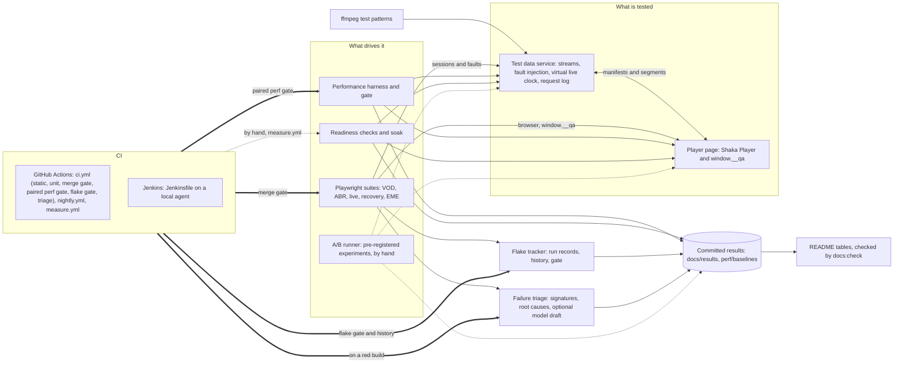

# Playback Proof

Playback Proof is a test lab for a web video player (Shaka Player on Media Source Extensions). It generates its own streams, injects network faults on purpose and plays the result in Chromium, Firefox and WebKit, so that startup, adaptation, recovery and live behaviour can be tested, measured and gated on a merge. Every number below is rendered from a result file committed in this repository, counted by a command that the text names, or taken from a document or a CI run that the text cites.

Stack: TypeScript (strict), Node.js 22, Shaka Player 5.3.3, Playwright 1.64.1, Vitest 5, ffmpeg.

The repository is public. It is a test lab on localhost with synthetic streams, not production monitoring: its numbers say nothing about a CDN, a real network or a hardware decoder (see [Limitations and honesty notes](#limitations-and-honesty-notes)).

## What this proves

The project makes three claims. Each row below is one clause of them, with what implements it, where the evidence is, and whether it is done. A clause that is only partly true says exactly how.

1. Defined the end-to-end test strategy for an open-source MSE web player across consumer web scenarios (VOD, live events); built a test data service for reproducible streams and Playwright suites for Chromium, Firefox and WebKit.
2. Ran the suites as merge gates in Jenkins and GitHub Actions; added A/B testing of player configurations on startup time and rebuffering, readiness checks for simulated live events, and AI-assisted failure triage that clusters CI failures by root cause.
3. Tracked flake rate and performance baselines (startup time, rebuffering, frame rate) on every build, failing merges on regressions.

| Claim | Implemented in | Evidence | Status |
| --- | --- | --- | --- |
| 1. A test strategy for an open-source MSE player across VOD and live scenarios | [`TEST_STRATEGY.md`](TEST_STRATEGY.md) (risk ranking, test catalog, gates, policy numbers), [`docs/decisions/strategy.md`](docs/decisions/strategy.md), [`tools/catalog.ts`](tools/catalog.ts), [`tools/check-specs.ts`](tools/check-specs.ts) | The catalog is checked against the specs, and the strategy's tables against the code, in the `static` job of every build ([CI run 41900113801](https://github.com/hanniavalera/playback-proof/actions/runs/41900113801)); [the suites](#the-suites) | Done |
| 1. A test data service for reproducible streams | [`src/server/`](src/server) (service), [`src/server/media/`](src/server/media) (ffmpeg generation, content-addressed cache), [`tools/generate-streams.ts`](tools/generate-streams.ts), [`tools/verify-streams.ts`](tools/verify-streams.ts) | One ffmpeg build gives identical bytes at any thread count ([ADR-045](docs/decisions/media.md)); [`tests/unit/media/specs.test.ts`](tests/unit/media/specs.test.ts) pins the cache key; every CI leg prints the content hash of the streams it plays ([`docs/CI.md`](docs/CI.md), "How the data moves") | Done, with a caveat: bytes are identical for one ffmpeg build only. CI generates with Ubuntu's ffmpeg 6.1, the development host runs 9.0.2, and the committed probe media differs between them ([codec matrix files](docs/results/codec-matrix)), so every environment has its own baselines |
| 1. Playwright suites for Chromium, Firefox and WebKit | [`tests/e2e/`](tests/e2e) (VOD, ABR, live, recovery, EME), [`playwright.config.ts`](playwright.config.ts), [`tests/e2e/support/`](tests/e2e/support) | [The suites](#the-suites); the five merge-gate legs are green on `main` ([CI run 41900113801](https://github.com/hanniavalera/playback-proof/actions/runs/41900113801)); the whole `@merge` tier ran 30 times in each Linux engine with no flaky and no failed execution ([Flake tracking](#flake-tracking)) | Done, with caveats: Linux WebKit is an experimental engine (a required check, flake-tracked); Firefox runs in CI and in Docker, not natively on the macOS development host; the EME test (ClearKey) is assigned to Chromium and Firefox; three ABR tests skip an attempt that cannot judge its claim, and the flake report counts those skips ([ADR-106](docs/decisions/e2e-abr.md)); on the macOS runner PB-ABR-002 is skipped as an invalid run in a share of its attempts, and PB-ABR-001 (release tier) failed most of its attempts before its classifier and now ends 21 of 40 repetitions as an invalid run, above the invalid-run budget |
| 2. Suites run as merge gates in GitHub Actions | [`.github/workflows/ci.yml`](.github/workflows/ci.yml), [`tools/gate-merge.ts`](tools/gate-merge.ts); branch protection on `main` requires ten checks: `static`, `unit`, the five `merge-gate` legs, `flake` and the two `perf` legs ([`docs/CI.md`](docs/CI.md), "Required checks"; [`TEST_STRATEGY.md`](TEST_STRATEGY.md) section 6.1) | [CI run 41900113801](https://github.com/hanniavalera/playback-proof/actions/runs/41900113801): every required check green; [`docs/CI.md`](docs/CI.md) | Done |
| 2. Suites run as merge gates in Jenkins | [`Jenkinsfile`](Jenkinsfile), [`docker-compose.yml`](docker-compose.yml), [`jenkins/`](jenkins), [`tests/unit/ci/parity.test.ts`](tests/unit/ci/parity.test.ts) (the two pipelines may not drift apart) | [Jenkins builds](#jenkins): two green builds and one red on purpose, with the evidence of each | Done, with caveats: Jenkins runs as a local docker-compose, not as a hosted service; the `Perf`, `Flake` and `Triage` stages are implemented in the Jenkinsfile and have not yet run in a Jenkins build (the committed builds predate them) |
| 2. A/B testing of player configurations on startup time and rebuffering | The two configurations under test ([`src/player/configs.ts`](src/player/configs.ts)), the experiment policy ([`TEST_STRATEGY.md`](TEST_STRATEGY.md) section 12, ADR-027), the runner and its statistics ([`ab/`](ab), `npm run ab`), the plans written and committed before the data ([`ab/prereg/`](ab/prereg)); [`docs/AB.md`](docs/AB.md), [ADR-140 to ADR-149](docs/decisions/ab.md) | [A/B comparisons](#ab-comparisons-of-the-player-configurations): three A/A pilots of the harness itself, two pre-registered experiments (startup under 300 ms of latency, and rebuffering under a bandwidth drop), both valid (7 of 7 gates) and both *equivalent within the margin* (keep A), and one exploratory run that has no verdict, in [`docs/results/ab`](docs/results/ab/README.md) | Done, with caveats: Chromium on one workstation (`local-darwin-arm64`), one stream, localhost, not replicated on a runner or in another engine; configuration B differs from A in four settings together, so no effect is credited to one of them; PB-AB-003 is a harm check, because nothing stalled in A and a share cannot fall below 0 (the two A/A pilots under that condition could not have failed for the same reason); the exploratory run decides nothing |
| 2. Readiness checks for simulated live events | [`live/readiness.ts`](live/readiness.ts), [`live/soak.ts`](live/soak.ts), [`src/lab/readiness/`](src/lab/readiness), [`tests/live/readiness.spec.ts`](tests/live/readiness.spec.ts), the virtual live clock ([`src/server/liveclock.ts`](src/server/liveclock.ts)); [ADR-150 to ADR-159](docs/decisions/readiness.md) | [Readiness and soak](#readiness-and-soak): result files of runs on GitHub-hosted runners, each joined to the run that made it ([manifest](docs/results/readiness/README.md)); [`docs/READINESS.md`](docs/READINESS.md) | Done, with caveats: one run of each case, on localhost, against a synthetic live stream, on shared runners: the checks detect regressions and pathologies and certify no latency a viewer gets; configuration A, what ships, is NO-GO on PB-RDY-003 in every run, which is the finding and not a failure of the run |
| 2. AI-assisted failure triage that clusters CI failures by root cause | [`triage/`](triage), [`src/lab/signature.ts`](src/lab/signature.ts), the `triage` job of [`ci.yml`](.github/workflows/ci.yml) (`if: failure()`, not a required check) and the `Triage` stage of the [`Jenkinsfile`](Jenkinsfile); [`docs/TRIAGE.md`](docs/TRIAGE.md) | [Failure triage](#failure-triage): seven induced failures read as one directory, and the `triage` job on a red pull request in GitHub Actions (63 failures across four engines became 3 clusters of 1 root cause); [`tests/unit/triage/real-failures.test.ts`](tests/unit/triage/real-failures.test.ts) pins the clusters | Done, with a caveat: the clustering is deterministic code and needs no key; the optional model draft per cluster was verified against a local mock only, because no API key exists in the development environment |
| 3. Flake rate tracked on every build | [`flake/`](flake) (reporter, history, report, gate), the `flake` and `flake-record` jobs of [`ci.yml`](.github/workflows/ci.yml), the history on the orphan branch `ci-data`; [`docs/FLAKE.md`](docs/FLAKE.md) | A pull request is judged against the history and every build of `main` that is not cancelled is recorded in it (`flake` and `flake-record` in [CI run 41900113801](https://github.com/hanniavalera/playback-proof/actions/runs/41900113801); `git show origin/ci-data:history/gha-linux-x64.jsonl`); [Flake tracking](#flake-tracking): the collections measured on GitHub's runners | Done, with caveats: Playwright runs only (unit tests are not tracked, and two of them flaked on CI); the history on `ci-data` is the long-run record and is young; the collections are counts, not rates |
| 3. Performance baselines (startup time, rebuffering, frame rate) | [`perf/`](perf), [`src/lab/measure/`](src/lab/measure), [`perf/baselines/`](perf/baselines); [`docs/PERF.md`](docs/PERF.md) | [Performance](#performance): baselines, derived thresholds, A/A checks and sensitivity checks | Done, with a caveat: committed baselines exist for two environments, the development workstation and its Playwright container; on GitHub's runners the gate does not use a committed baseline (next row) |
| 3. ... on every build | `npm run gate:perf -- --paired` ([`perf/gate.ts`](perf/gate.ts)); the `perf (chromium)` and `perf (chromium-cpu4x)` legs of [`ci.yml`](.github/workflows/ci.yml); the `Perf` stage of the [`Jenkinsfile`](Jenkinsfile); [ADR-178 and ADR-179](docs/decisions/perf-paired.md), [`docs/PERF.md`](docs/PERF.md) | [Performance](#performance): the paired gate against itself on GitHub-hosted VMs, no false positive ([`paired-aa`](docs/results/perf/paired-aa/README.md)); both legs ran in [CI run 41900113801](https://github.com/hanniavalera/playback-proof/actions/runs/41900113801) | Done on GitHub, with caveats: both legs run on every pull request and every push to `main` and are required checks, and the head is judged against a control measured on the same machine; Chromium and its throttled profile only (Firefox and WebKit baselines are too noisy to gate); the A/A bounds the false-positive rate and does not show it zero; the `Perf` stage of the Jenkinsfile has not yet run in a Jenkins build |
| 3. ... failing merges on regressions | The merge gate, the paired performance gate and the flake gate are required checks | A pull request that slowed startup by 150 ms failed both perf legs ([`paired-sensitivity.md`](docs/results/perf/paired-sensitivity.md), [CI run 41887534070](https://github.com/hanniavalera/playback-proof/actions/runs/41887534070)); one that blocked the player page's scripts failed `unit`, all five merge-gate legs and both perf legs ([`ci-demo.md`](docs/results/triage/ci-demo.md), [CI run 41887574166](https://github.com/hanniavalera/playback-proof/actions/runs/41887574166)); both were closed unmerged; Jenkins build 6 turns red engine by engine on a deliberate regression ([Jenkins builds](#jenkins)) | Done, with caveats: one performance regression of one size on one day, and the throttled leg caught it at its edge (its fresh batch was worse by 80.65 ms against 80 ms allowed); a smaller regression passes by design ([Performance](#performance)); in the same pull request the Firefox leg failed in its setup step for a cause that is not the change, so it is not a clean "only perf failed" demonstration |

## Architecture



Solid arrows are what runs on every build. Dotted ones are run by hand (`measure.yml`: baselines, readiness, soak and flake collections; the A/B runner, `npm run ab`, on a quiet machine). The Playwright suites, the performance harness and the readiness checks all drive the same player page through the same hook and configure the same service; the service gives every test a session of its own, so tests that run in parallel cannot disturb each other.

| Component | Path | What it does | Read |
| --- | --- | --- | --- |
| Test data service | [`src/server/`](src/server) | A `node:http` service: one isolated session per test, DASH and HLS manifests, segments, faults (throttle, latency, status, stall, abort, live stall, stale manifest), a virtual live clock over looped content, a request log | [`docs/CONTRACTS.md`](docs/CONTRACTS.md) sections 3 to 5, [decisions](docs/decisions/server.md) |
| Media pipeline | [`src/server/media/`](src/server/media) | ffmpeg test-pattern streams (VP9 video, AAC or Opus audio) as CMAF and WebM, DASH and HLS builders, the `tfdt` rewrite that loops live content, ClearKey encryption, a content-addressed cache | [decisions](docs/decisions/media.md) |
| Shared contracts | [`src/shared/`](src/shared) | Types of streams, faults, URLs and the `window.__qa` hook, and every policy number (`criteria.ts`) | [`docs/CONTRACTS.md`](docs/CONTRACTS.md) |
| Player page | [`src/player/`](src/player) | Shaka Player with the `window.__qa` hook: an event timeline with a cursor, metrics as pure functions of it, and configurations A (Shaka's defaults) and B (four overridden settings) | [`docs/METRICS.md`](docs/METRICS.md), [decisions](docs/decisions/player.md) |
| Lab libraries | [`src/lab/`](src/lab) | The codec probe, the performance measurement library, the readiness checks, the service client, the documented gaps | [codecs](docs/decisions/codecs.md), [perf](docs/decisions/perf.md), [readiness](docs/decisions/readiness.md) |
| Playwright suites | [`tests/e2e/`](tests/e2e), [`tests/live/`](tests/live) | The browser tests, written against the hook and the service's request log; no fixed sleeps (ESLint enforces it) | [`TEST_STRATEGY.md`](TEST_STRATEGY.md), [`docs/CONTRACTS.md`](docs/CONTRACTS.md) section 7 |
| Unit tests | [`tests/unit/`](tests/unit) | Vitest tests of the lab itself, including tests that run the real ffmpeg | [`TEST_STRATEGY.md`](TEST_STRATEGY.md) |
| Performance harness | [`perf/`](perf) | Baselines per environment, the gate (on a shared runner, against a control measured on the same machine), the A/A check and the threshold derivation | [`docs/PERF.md`](docs/PERF.md), [ADR-178 and ADR-179](docs/decisions/perf-paired.md) |
| Readiness and soak | [`live/`](live) | The live-event checks and the long soak session | [`docs/READINESS.md`](docs/READINESS.md), [decisions](docs/decisions/readiness.md) |
| A/B harness | [`ab/`](ab) | Pre-registered plans, an interleaved runner that refuses a plan git cannot show committed first, the statistics (Mann-Whitney, Hodges-Lehmann shift, Fisher's exact test, Holm), the A/A calibration, a decision rule with four verdicts and a validity table for every run | [`docs/AB.md`](docs/AB.md), [ADR-140 to ADR-149](docs/decisions/ab.md) |
| Flake tracker | [`flake/`](flake) | Reporter, history, quarantine list, report and gate | [`docs/FLAKE.md`](docs/FLAKE.md) |
| Failure triage | [`triage/`](triage) | Signatures, root-cause rules, redaction, optional model drafts | [`docs/TRIAGE.md`](docs/TRIAGE.md) |
| CI | [`.github/workflows/`](.github/workflows), [`Jenkinsfile`](Jenkinsfile), [`jenkins/`](jenkins), [`docker-compose.yml`](docker-compose.yml) | The merge gate, the paired performance gate, the flake gate, the triage job and the nightly release tier on GitHub, and the manual measurements; the same gate stages on a local Jenkins | [`docs/CI.md`](docs/CI.md), [`jenkins/README.md`](jenkins/README.md) |
| Tools | [`tools/`](tools) | Stream generation and verification, the codec matrix, the documentation checks and the generator of the tables below | [`docs/README-TOOLING.md`](docs/README-TOOLING.md) |

## Quick start

**Prerequisites.**

- Node.js 22.13 or newer (`engines` in [`package.json`](package.json); CI installs the version in [`.nvmrc`](.nvmrc)).
- ffmpeg on the `PATH`, to generate the streams and for the media unit tests. CI uses Ubuntu's 6.1.1 (the `streams` job); the development host runs 9.0.2.
- Playwright's browsers: `npx playwright install chromium firefox webkit` (on Linux add `--with-deps`, which is what each CI leg does).
- Docker is optional: it runs Firefox on a macOS host, where Playwright's Firefox does not start, and reproduces the Linux environment (`npm run docker:pw`); it also runs the local Jenkins.

**The shortest sequence that shows something working, in order.**

```sh
npm ci                                       # the locked dependencies
npx playwright install chromium              # one browser is enough to start
npm run generate:streams                     # the lab's streams, once, into .cache/streams
npm run build:player                         # the player page, into dist/player
npm run gate:static                          # typecheck, lint, format, docs, specs, codec matrix freshness
npm run gate:merge -- --project=chromium     # the @merge Playwright tests in Chromium
```

| Step | What happens | Time | Verified by |
| --- | --- | --- | --- |
| `npm ci` | Installs the locked dependencies. | Not measured here. | The `setup` action of every CI job. |
| `npm run generate:streams` | Encodes the five streams with ffmpeg and prints their content hashes; a complete cache is a no-op. | 176 s with a cold cache on the Jenkins agent, 1 s with a warm one ([Jenkins builds](#jenkins), `Streams` stage of builds 3 and 4). | The `streams` job of CI. |
| `npm run build:player` | Writes `dist/player`; the service refuses to serve without it. | Under a second (0.4 s on the development host). | Every `merge-gate` leg runs it; run for this README. |
| `npm run gate:static` | Typecheck, lint, format check, docs check (this README's tables included), specs check, codec matrix freshness. | 34 s for the `static` job. | The `static` job ([CI run 41900113801](https://github.com/hanniavalera/playback-proof/actions/runs/41900113801)); run for this README. |
| `npm run gate:merge -- --project=chromium` | Starts the service through Playwright's `webServer` and runs the merge-tier tests of that engine; the HTML report is `reports/html`, the JSON report `reports/playwright.json`. | 1 min 48 s for the whole `merge-gate (chromium)` job. | The `merge-gate (chromium)` job of the same run. |

The unit suite is `npm run gate:unit` (Vitest; it runs the real ffmpeg, so ffmpeg must be installed): the `unit` job took 1 min 24 s in that run. Firefox on a macOS host runs in the Playwright image: `npm run docker:pw -- npm run gate:merge -- --project=firefox` is the command [`docs/CI.md`](docs/CI.md) gives ("Reproducing a job locally"; not run for this README), and the committed `docker-linux-arm64` codec matrix was recorded through the same wrapper.

## How to run everything

Each row is a script of [`package.json`](package.json), or the tool behind it. Times are the ones the documents or the committed results give; where none is given the row says so. The commands that CI runs are the ones marked in the quick start; the others are quoted from the document in the last column, and were not run for this README.

| Area | Command | What it does | Time, and what it needs | Read |
| --- | --- | --- | --- | --- |
| Gates | `npm run gate:static` | Typecheck, lint, format, docs and specs checks, codec matrix freshness | 34 s in CI ([run 41900113801](https://github.com/hanniavalera/playback-proof/actions/runs/41900113801), the times below too) | [`TEST_STRATEGY.md`](TEST_STRATEGY.md) section 6.1 |
| Gates | `npm run gate:unit`, `npm run test:unit` | The Vitest suite of the lab (`gate:unit` is the CI stage and runs `test:unit`) | 1 min 24 s in CI; needs ffmpeg | [`docs/CI.md`](docs/CI.md) |
| Gates | `npm run gate:merge -- --project=<project>` | The `@merge` Playwright tests of one project (`chromium`, `firefox`, `chromium-cpu4x` or `webkit`); quarantined tests run apart, non-blocking | 1 min 48 s to 3 min 43 s per leg in CI; needs the streams, the player build and the browser | [`docs/FLAKE.md`](docs/FLAKE.md) |
| Gates | `npm run gate:flake` | Judges this build's runs against the history of their environment and the quarantine list; a test whose invalid runs exceed their budget fails it too | 20 s for the `flake` job in CI | [`docs/FLAKE.md`](docs/FLAKE.md) |
| Gates | `npm run gate:perf -- --paired --control-ref <ref> --profile <profile>` | The performance scenarios of one profile: the base commit is measured first on this machine, then the head is judged against it; fails only when a regression reproduces; without `--paired` the gate judges against the committed baseline of this environment | 10 min 51 s for `perf (chromium)` and 3 min 19 s for `perf (chromium-cpu4x)` in CI (the control is measured too); needs a machine to itself | [`docs/PERF.md`](docs/PERF.md) |
| Gates | `npm run gate:triage` | Clusters the failures of a red build; never decides a verdict | Not measured (skipped on a green run) | [`docs/TRIAGE.md`](docs/TRIAGE.md) |
| Checks | `npm run typecheck`, `npm run lint`, `npm run format:check`, `npm run format` | TypeScript, ESLint (no fixed sleeps in specs), Prettier (`format` rewrites, `format:check` only checks) | Part of `gate:static` (all but `format`) | [`docs/CONTRACTS.md`](docs/CONTRACTS.md) section 10 |
| Checks | `npm run docs:check` | Relative links, the test catalog, every generated block of `TEST_STRATEGY.md` and of this README; `-- --write` rewrites the blocks, `-- --print` shows them | Part of `gate:static` | [`docs/README-TOOLING.md`](docs/README-TOOLING.md) |
| Checks | `npm run specs:check` | Every Playwright test is a row of the catalog, with the tags the row asks for; `-- --complete` also asks for a spec for every browser row | Part of `gate:static` | [`TEST_STRATEGY.md`](TEST_STRATEGY.md) section 14 |
| Streams and service | `npm run generate:streams`, `npm run verify:streams` | Generate the streams; check them against ffprobe and ffmpeg | See Quick start; needs ffmpeg | [`docs/CONTRACTS.md`](docs/CONTRACTS.md) section 3 |
| Streams and service | `npm run build:player`, `npm run serve` | Build the player page; start the service on `PB_PORT` (default 4600) | Not measured | [`docs/CONTRACTS.md`](docs/CONTRACTS.md) sections 4 and 8 |
| Streams and service | `npm run smoke:service`, `npm run bench:server`, `npm run player:smoke` | The service against the real streams; what the service adds to a response (run alone, on a quiet machine); real sessions in real browsers through the hook | Not measured | [`docs/CONTRACTS.md`](docs/CONTRACTS.md) |
| Browser tests | `npm run test:e2e`, `npm run test:merge`, `npm run test:release` | Playwright: every test, the merge tier, the release tier | Not measured | [`TEST_STRATEGY.md`](TEST_STRATEGY.md) section 6 |
| Codecs | `npm run codec-matrix -- --browsers chromium,firefox,webkit --attempts 5` | Probes what each installed browser really decodes and writes `docs/results/codec-matrix/<envId>.json`; `-- --render` regenerates the matrix, `-- --check` fails when it is stale | Not measured | [`docs/CODEC_MATRIX.md`](docs/CODEC_MATRIX.md) |
| Docker | `npm run docker:pw -- [--cpus N] <command>` | Runs a command in the Playwright Linux image: Firefox on a Mac, the Linux environment | Not measured | [ADR-036](docs/decisions/codecs.md) |
| Performance | `npm run perf`, `npm run perf:baseline`, `npm run perf:gate` | Measure; record the baseline of this environment; gate against it | About 6 to 7 min for Chromium and its throttled profile on the workstation ([`TEST_STRATEGY.md`](TEST_STRATEGY.md) section 6.3); needs a quiet machine | [`docs/PERF.md`](docs/PERF.md) |
| Performance | `npm run perf:aa`, `npm run perf:derive`, `npm run perf:quiet` | Summarise an A/A check; derive the thresholds from the baselines; wait for a quiet machine, then run a command | Not measured | [`docs/PERF.md`](docs/PERF.md) |
| Flake | `npm run flake:report`, `npm run flake:gate`, `npm run flake:collect -- --project chromium --runs 30 --grep @merge` | The report of the history; the gate; repeat the suite to gather real flake data (start `npm run serve` first); the collections measured so far are in [`docs/results/flake`](docs/results/flake) | Not measured | [`docs/FLAKE.md`](docs/FLAKE.md) |
| Readiness | `npm run readiness -- --engine chromium --candidate live-sync` | The live-event checks, with a go or no-go verdict per line; writes `docs/results/readiness`; needs the machine to itself | The `Duration` column of the [manifest](docs/results/readiness/README.md) for the runs on GitHub | [`docs/READINESS.md`](docs/READINESS.md), [decisions](docs/decisions/readiness.md) |
| Soak | `npm run soak -- --engine chromium --minutes ci` | A long live session with one injected outage; `--minutes release` is the long one | 5.3 minutes for `ci`, about 30.5 for `release` ([ADR-159](docs/decisions/readiness.md)) | [`docs/READINESS.md`](docs/READINESS.md), [decisions](docs/decisions/readiness.md) |
| Results tables | `npm run results:docs` | Checks (`-- --write` rewrites) the tables of `docs/READINESS.md` and of the readiness manifest; part of `docs:check`, like the tables of this README | Part of `gate:static` | [`docs/README-TOOLING.md`](docs/README-TOOLING.md) |
| A/B | `npm run ab -- --prereg ab/prereg/<id>.json` | Runs one pre-registered experiment: refuses a plan that git cannot show committed and unmodified, interleaves the two configurations, writes the raw results, the report and its validity table to `docs/results/ab`; `-- --report <raw file>` writes a report again with no browser | 7 min 20 s for PB-AB-002 and 63 min 28 s for PB-AB-003 on the workstation (the `run` timestamps of their reports); one command at a time, on a machine whose 1-minute load is at most half its CPUs | [`docs/AB.md`](docs/AB.md), [ADR-140 to ADR-149](docs/decisions/ab.md) |
| Triage | `npm run triage -- --from reports` | Clusters the failures of a Playwright run by root cause; `--summarize` adds optional model drafts (needs `ANTHROPIC_API_KEY`) | Not measured | [`docs/TRIAGE.md`](docs/TRIAGE.md) |
| Jenkins | `bash jenkins/init-env.sh`, then `docker compose up -d --build` | A controller and a Linux agent on a laptop; start a build from the UI or with `npx tsx tools/jenkins-evidence.ts --trigger` | About a minute to become healthy; a green build took 261 to 371 s ([Jenkins builds](#jenkins)) | [`jenkins/README.md`](jenkins/README.md) |
| Measurements on GitHub | `gh workflow run measure.yml --ref <ref> -f task=<task> ...` | One long measurement (baseline, A/A, A/B, readiness, soak, flake collection) on a GitHub runner | Per task | [`docs/CI.md`](docs/CI.md), "Measurements on GitHub runners" |

## Real results

The result tables of this section are rendered by [`tools/results-tables.ts`](tools/results-tables.ts) from files committed in this repository, and `npm run docs:check` fails when one differs from them (`npm run docs:check -- --write` rewrites it); the table of what is not committed yet, at the end, is written by hand. Each result carries the id of its environment (`local-darwin-arm64`, `docker-linux-arm64`, `gha-linux-x64`, `gha-macos-arm64`, `jenkins-linux-arm64`), and numbers are never compared across environments. The text around a table says what it shows and what it does not.

### Codecs and engines

<!-- BEGIN:RESULTS_CODEC -->
| Environment | OS | Engine | `cmaf-vp9-aac` | `cmaf-vp9-opus` | `webm-vp9-opus` | `cmaf-h264-aac` |
| --- | --- | --- | --- | --- | --- | --- |
| `docker-linux-arm64` | Ubuntu 24.04.5 LTS arm64 | chromium 156.0.8078.4 | ok 5/5 | ok 5/5 | ok 5/5 | ok 5/5 |
| `docker-linux-arm64` | Ubuntu 24.04.5 LTS arm64 | firefox 157.0 | ok 5/5 | ok 5/5 | ok 5/5 | ok 5/5 |
| `docker-linux-arm64` | Ubuntu 24.04.5 LTS arm64 | webkit 27.2 | intermittent 2/5 * | intermittent 4/5 * | intermittent 2/5 * | intermittent 3/5 * |
| `gha-linux-x64` | Ubuntu 24.04.5 LTS x64 | chromium 156.0.8078.4 | ok 5/5 | ok 5/5 | ok 5/5 | ok 5/5 |
| `gha-linux-x64` | Ubuntu 24.04.5 LTS x64 | firefox 157.0 | ok 5/5 | ok 5/5 | ok 5/5 | ok 5/5 |
| `gha-linux-x64` | Ubuntu 24.04.5 LTS x64 | webkit 27.2 | fail 0/5 * | intermittent 2/5 * | fail 0/5 * | intermittent 2/5 * |
| `gha-macos-arm64` | macOS 15.8.2 arm64 | chromium 156.0.8078.4 | ok 5/5 | ok 5/5 | ok 5/5 | ok 5/5 |
| `gha-macos-arm64` | macOS 15.8.2 arm64 | firefox 157.0 | ok 5/5 | ok 5/5 | ok 5/5 | ok 5/5 |
| `gha-macos-arm64` | macOS 15.8.2 arm64 | webkit 27.2 | ok 5/5 | fail 0/5 | ok 5/5 | ok 5/5 |
| `local-darwin-arm64` | macOS 27.2 arm64 | chromium 156.0.8078.4 | ok 5/5 | ok 5/5 | ok 5/5 | ok 5/5 |
| `local-darwin-arm64` | macOS 27.2 arm64 | firefox | did not launch | n/a | n/a | n/a |
| `local-darwin-arm64` | macOS 27.2 arm64 | webkit 27.2 | ok 5/5 | fail 0/5 | ok 5/5 | ok 5/5 |

Each cell is the attempts that played out of the attempts made: 5 attempts per case, each in a fresh browser process; an attempt passes when media time reaches 1 s and, for video, at least 5 frames were presented.

`*` marks a cell where `MediaSource.isTypeSupported` answered yes for every track of the flavour and the engine still did not decode every attempt: the reason the lab trusts a probe that decodes and not the answer of the API.

Lab flavours the probe could not rely on, or engines it could not start: `docker-linux-arm64`: webkit does not decode every attempt of `cmaf-vp9-aac` and `webm-vp9-opus`; `gha-linux-x64`: webkit does not decode every attempt of `cmaf-vp9-aac` and `webm-vp9-opus`; `local-darwin-arm64`: firefox does not launch.

The whole matrix (single tracks, plain-video controls, the sensitivity runs and what each engine claims) is [docs/CODEC_MATRIX.md](docs/CODEC_MATRIX.md), rendered from [docker-linux-arm64.json](docs/results/codec-matrix/docker-linux-arm64.json), [gha-linux-x64.json](docs/results/codec-matrix/gha-linux-x64.json), [gha-macos-arm64.json](docs/results/codec-matrix/gha-macos-arm64.json), [local-darwin-arm64.json](docs/results/codec-matrix/local-darwin-arm64.json).
<!-- END:RESULTS_CODEC -->

What it shows: which of the lab's stream flavours each engine decodes in each environment, measured by playing real media through Media Source Extensions in a fresh browser process, and not by asking `MediaSource.isTypeSupported`, which the rows marked `*` show to be unreliable. The suites choose their stream from this evidence, and an engine that cannot decode what the lab streams is a documented gap that a spec skips with the reason ([ADR-030](docs/decisions/codecs.md), [ADR-034](docs/decisions/codecs.md)). What it does not show: that the player works in an engine; the probe plays one second of a test pattern, and the suites do the rest.

### The suites

<!-- BEGIN:RESULTS_SUITES -->
The catalog of [TEST_STRATEGY.md](TEST_STRATEGY.md) has 57 rows; 42 Playwright tests exist in 11 spec files (`tests/e2e`: 37 tests and `tests/live`: 5 tests), counted from the `test(...)` calls of the specs.

| Area | Runs in | Catalog rows | Merge tier | Release tier | Playwright tests |
| --- | --- | --- | --- | --- | --- |
| `VOD` VOD playback | `e2e` | 13 | 6 | 7 | 13 |
| `ABR` Adaptive bitrate | `e2e` | 7 | 1 | 6 | 7 |
| `LIVE` Live playback | `e2e` | 6 | 4 | 2 | 6 |
| `REC` Recovery | `e2e` | 9 | 3 | 6 | 9 |
| `RDY` Live readiness | `live` | 5 | 0 | 5 | 5 |
| `PERF` Performance | `perf` | 4 | 4 | 0 | - |
| `AB` Experiments | `ab` | 3 | 0 | 3 | - |
| `ENV` Environment | `e2e` and `unit` | 2 | 2 | 0 | 1 |
| `EME` Encrypted media | `e2e` | 1 | 0 | 1 | 1 |
| `LAB` The lab itself | `unit` | 7 | 7 | 0 | - |
| **All** |  | 57 | 27 | 30 | 42 |

| CI leg | Playwright project | Runner | Merge gate: `--grep "@merge"` | Nightly: `--grep "@merge\|@release" --grep-invert "@readiness"` |
| --- | --- | --- | --- | --- |
| `chromium` | `chromium` | `ubuntu-24.04` | 15 | 37 |
| `firefox` | `firefox` | `ubuntu-24.04` | 15 | 37 |
| `chromium-cpu4x` | `chromium-cpu4x` | `ubuntu-24.04` | 3 | 3 |
| `webkit-linux` (experimental) | `webkit` | `ubuntu-24.04` | 15 | 37 |
| `webkit-macos` | `webkit` | `macos-15` | 15 | 37 |

| Performance leg | Profile | Runner | Control (pull request or push) | Command |
| --- | --- | --- | --- | --- |
| `perf (chromium)` | `chromium` | `ubuntu-24.04` | `HEAD^1` | `npm run gate:perf -- --paired --control-ref "$CONTROL_REF" --profile chromium` |
| `perf (chromium-cpu4x)` | `chromium-cpu4x` | `ubuntu-24.04` | `HEAD^1` | `npm run gate:perf -- --paired --control-ref "$CONTROL_REF" --profile chromium-cpu4x` |

A leg runs the tests its `--grep` selects (the patterns are read from the workflow and the merge-gate script, and matched against the tags of the specs), and in the throttled project only the `@cpu` ones; a test an engine cannot run is skipped with its reason, not left out. A leg's runner and project are read from [.github/workflows/ci.yml](.github/workflows/ci.yml) and [.github/workflows/nightly.yml](.github/workflows/nightly.yml); a performance leg runs the paired performance gate of its profile ([docs/PERF.md](docs/PERF.md)), not Playwright tests.
<!-- END:RESULTS_SUITES -->

What it shows: what exists and where it runs. The counts come from the specs themselves and the workflow files: a test added without a catalog row fails `npm run specs:check`, and a leg added to a workflow, or a `--grep` changed, makes this table stale, which fails `npm run docs:check`. The nightly leaves out the five `@readiness` tests of `tests/live`, which take minutes each and are red for configuration A by design (`--grep-invert "@readiness"`, [ADR-153](docs/decisions/readiness.md)): they run on demand, through `measure.yml` and through `npm run readiness`. What it does not show: whether the tests pass. That is the verdict of a run, and [CI run 41900113801](https://github.com/hanniavalera/playback-proof/actions/runs/41900113801) is one, with every required check green. The `chromium-cpu4x` leg runs the `@cpu` subset in Chromium with a 4x CPU throttle; Firefox and WebKit have no equivalent. A performance leg runs no Playwright test: it runs the paired performance gate of its profile ([Performance](#performance)).

### Performance

<!-- BEGIN:RESULTS_PERF -->
**Baselines** (one file per environment and profile)

| Environment | Profile | Browser | Recorded | Startup median / p90 (scenario) | Startup CV | Startup gate | Metrics gated / tracked |
| --- | --- | --- | --- | --- | --- | --- | --- |
| `docker-linux-arm64` | `chromium` | chromium 156.0.8078.4 | 2026-11-04, `0dfbed1` | 39.65 / 44.58 ms (PB-PERF-001) | 13.3 % | gated | 6 / 5 |
| `docker-linux-arm64` | `firefox` | firefox 157.0 | 2026-11-04, `58da1b2` | 54 / 61.2 ms (PB-PERF-001) | 15.3 % | tracked: CV above the 15 % limit | 5 / 6 |
| `docker-linux-arm64` | `webkit` | webkit 27.2 | 2026-11-04, `8661aed` | 156.5 / 283.8 ms (PB-PERF-001) | 56.7 % | tracked: CV above the 15 % limit | 5 / 6 |
| `local-darwin-arm64` | `chromium-cpu4x` | chromium 156.0.8078.4 | 2026-11-04, `90df3a0` | 111.45 / 114.71 ms (PB-PERF-004) | 6.4 % | gated | 2 / 5 |
| `local-darwin-arm64` | `chromium` | chromium 156.0.8078.4 | 2026-11-04, `7389861` | 37.05 / 39.03 ms (PB-PERF-001) | 4.0 % | gated | 6 / 5 |
| `local-darwin-arm64` | `webkit` | webkit 27.2 | 2026-11-04, `e8d31c4` | 80.5 / 87.1 ms (PB-PERF-001) | 6.8 % | gated | 6 / 5 |

Every baseline is 10 measured runs per scenario after 1 warm-up run that is recorded and left out. Startup is the time from load requested to first frame presented, median / p90. A tracked metric is reported on every build and can neither fail it nor start a re-measure; the last column counts the metrics of the profile that gate and that are tracked (a metric with no rule is tracked too).

**What the baselines say about the thresholds** (relative rules: how much two batches of the same code differ, against what the committed policy allows)

| Rule | Gated pairs | Tracked pairs | Largest noise, median / tail (share of the baseline) | Derived allowance, median / tail, and floor | Smallest margin of the committed policy, median / tail |
| --- | --- | --- | --- | --- | --- |
| `startup` (PB-PERF-001 startupMs) | 3 | 2 | 23.2 % / 22.6 % | 30 % / 30 %, floor 5 ms | 1.3x / 1.3x |
| `fps` (PB-PERF-002 fps) | 5 | 0 | 0.0 % / 0.0 % | 5 % / 5 %, floor 0 fps | over 1,000x / over 1,000x |
| `lowEndStartup` (PB-PERF-004 startupMs) | 1 | 0 | 10.2 % / 11.7 % | 15 % / 15 %, floor 20 ms | 2.9x / 2.6x |

**Rules judged by an absolute budget: what the baselines contain**

| Rule | Metric | Baseline runs | Runs above zero | Largest value |
| --- | --- | --- | --- | --- |
| `frameDropped` | `droppedRatio` | 50 | 0 | 0 |
| `rebufferCount` | `rebufferCount` | 50 | 0 | 0 |
| `rebufferMs` | `rebufferMs` | 50 | 0 | 0 ms |
| `rebufferRatio` | `rebufferRatio` | 50 | 0 | 0 |
| `lowEndDropped` | `droppedRatio` | 10 | 0 | 0 |

[threshold-derivation.md](docs/results/perf/threshold-derivation.md) has the arithmetic; [docs/PERF.md](docs/PERF.md) says how to read and re-record a baseline.

**A/A checks** (the gate against its own baseline, or against a control measured on the same machine, with nothing changed)

| Set | Environment | Profile | Passes | Exit 0 / 1 / 2 | False positives | First-batch alarms (not reproduced) |
| --- | --- | --- | --- | --- | --- | --- |
| committed baseline, first run | `docker-linux-arm64` | `chromium` | 5 | 5 / 0 / 0 | 0 | 0 (0) |
| committed baseline, first run | `docker-linux-arm64` | `firefox` | 5 | 2 / 0 / 3 | 0 | 0 (0) |
| committed baseline, first run | `docker-linux-arm64` | `webkit` | 5 | 5 / 0 / 0 | 0 | 0 (0) |
| committed baseline, first run | `local-darwin-arm64` | `chromium` | 10 | 10 / 0 / 0 | 0 | 0 (0) |
| committed baseline, first run | `local-darwin-arm64` | `chromium-cpu4x` | 5 | 5 / 0 / 0 | 0 | 0 (0) |
| committed baseline, first run | `local-darwin-arm64` | `webkit` | 5 | 5 / 0 / 0 | 0 | 0 (0) |
| committed baseline, after a harness fix | `docker-linux-arm64` | `firefox` | 5 | 5 / 0 / 0 | 0 | 0 (0) |
| committed baseline, after a harness fix | `local-darwin-arm64` | `chromium` | 2 | 2 / 0 / 0 | 0 | 0 (0) |
| committed baseline, GitHub VMs | `gha-linux-x64` | `chromium` | 18 | 18 / 0 / 0 | 0 | 0 (0) |
| committed baseline, GitHub VMs | `gha-linux-x64` | `chromium-cpu4x` | 12 | 6 / 6 / 0 | 6 | 6 (0) |
| committed baseline, GitHub VMs | `gha-linux-x64` | `firefox` | 9 | 7 / 2 / 0 | 2 | 2 (0) |
| paired control, GitHub VMs | `gha-linux-x64` | `chromium` | 18 | 18 / 0 / 0 | 0 | 0 (0) |
| paired control, GitHub VMs | `gha-linux-x64` | `chromium-cpu4x` | 18 | 18 / 0 / 0 | 0 | 0 (0) |

| Set | A/A passes | False positives (a pass that exited 1 with nothing changed) | Machines |
| --- | --- | --- | --- |
| committed baseline, first run | 35 | 0 | one machine |
| committed baseline, after a harness fix | 7 | 0 | one machine |
| committed baseline, GitHub VMs | 39 | 8 | 13 VMs on 5 CPU models |
| paired control, GitHub VMs | 36 | 0 | 12 VMs on 5 CPU models |

On GitHub-hosted VMs, by the CPU model the job landed on (a runner label is a pool of machines):

| CPU model | committed baseline, GitHub VMs | paired control, GitHub VMs |
| --- | --- | --- |
| AMD EPYC 7763 | 4 VMs, 12 passes, 8 reproduced regressions | 4 VMs, 12 passes, 0 reproduced regressions |
| AMD EPYC 9V45 | 3 VMs, 9 passes, 0 reproduced regressions | - |
| AMD EPYC 9V74 | 4 VMs, 12 passes, 0 reproduced regressions | 2 VMs, 6 passes, 0 reproduced regressions |
| Intel Xeon 6975P-C | 1 VM, 3 passes, 0 reproduced regressions | 3 VMs, 9 passes, 0 reproduced regressions |
| Intel Xeon Platinum 8370C | - | 2 VMs, 6 passes, 0 reproduced regressions |
| Intel Xeon Platinum 8573C | 1 VM, 3 passes, 0 reproduced regressions | 1 VM, 3 passes, 0 reproduced regressions |

- `docker-linux-arm64` `firefox` (committed baseline, first run): 3 of 5 passes ended with exit code 2, a measurement problem and never a regression; the first line of the first one: `PB-PERF-002 on firefox, run 1 of 10: qa.waitFor('firstframe'): qa.waitFor('firstframe') timed out after 15000 ms (looking from index 0).`

**Sensitivity** (a regression injected on purpose, and what the gate did)

| Injected on purpose | Measured | Runs | Final verdicts |
| --- | --- | --- | --- |
| +2 ms on manifest and init | chromium PB-PERF-001 startupMs | 1 | 1 pass |
| +5 ms on manifest and init | chromium PB-PERF-001 startupMs | 1 | 1 pass |
| +6 ms on manifest and init | chromium PB-PERF-001 startupMs | 3 | 3 pass |
| +7 ms on manifest and init | chromium PB-PERF-001 startupMs | 3 | 1 regression, 2 not-reproduced |
| +8 ms on manifest and init | chromium PB-PERF-001 startupMs | 3 | 2 regression, 1 pass |
| +9 ms on manifest and init | chromium PB-PERF-001 startupMs | 3 | 3 regression |
| +10 ms on manifest and init | chromium PB-PERF-001 startupMs | 4 | 4 regression |
| +20 ms on manifest and init | chromium PB-PERF-001 startupMs | 1 | 1 regression |
| +40 ms on manifest and init | chromium PB-PERF-001 startupMs | 1 | 1 regression |
| +80 ms on manifest and init | chromium PB-PERF-001 startupMs | 1 | 1 regression |
| +150 ms on manifest and init | chromium PB-PERF-001 startupMs | 1 | 1 regression |
| first batch only: +150 ms on manifest and init | chromium PB-PERF-001 startupMs | 3 | 3 not-reproduced |
| CPU throttle 1.25x | chromium PB-PERF-001 startupMs | 1 | 1 pass |
| CPU throttle 1.5x | chromium PB-PERF-001 startupMs | 1 | 1 pass |
| CPU throttle 2x | chromium PB-PERF-001 startupMs | 1 | 1 regression |
| CPU throttle 3x | chromium PB-PERF-001 startupMs | 1 | 1 regression |
| CPU throttle 4x | chromium PB-PERF-001 startupMs | 1 | 1 regression |
| CPU throttle 8x (instead of 4x) | chromium-cpu4x PB-PERF-004 startupMs | 1 | 1 regression |
| CPU throttle 20x | chromium PB-PERF-002 | 1 | 1 problem |
| `{"type":"latency","ms":8000,"times":1,"match":{"kind":"segment","track":"video","number":4}}`, 5 runs a batch | chromium PB-PERF-003 rebufferCount | 1 | 1 regression |
| `{"type":"latency","ms":8000,"times":1,"match":{"kind":"segment","track":"video","number":4}}`, 5 runs a batch | chromium PB-PERF-003 rebufferMs | 1 | 1 regression |
| `{"type":"latency","ms":8000,"times":1,"match":{"kind":"segment","track":"video","number":4}}`, 5 runs a batch | chromium PB-PERF-003 rebufferRatio | 1 | 1 regression |

35 rows in [docs/results/perf/sensitivity/summary.md](docs/results/perf/sensitivity/summary.md). `regression`: the metric failed in the first batch and again in a fresh browser, so the merge fails; `not-reproduced`: it failed once only, the first measurement is discarded and the merge passes; `pass`: it never failed; `problem`: the measurement could not be trusted.

**A regression on a pull request** (what the paired gate did with it)

| Profile | Scenario and metric | Control (median) | Head, first batch | Fresh batch | Allowed on the median | Verdict | CPU model |
| --- | --- | --- | --- | --- | --- | --- | --- |
| `chromium` | PB-PERF-001 `startupMs` | 58.95 ms | 200.6 ms (+240.3 %; p90 +220.2 %) | 192.3 ms (+226.1 %), worse by 133.3 ms | 17.69 ms (30 % of the control, floor 5 ms) | regression | Intel Xeon 6973P-C for both |
| `chromium-cpu4x` | PB-PERF-004 `startupMs` | 266.7 ms | 354.9 ms (+33.1 %; p90 +32.2 %) | 347.3 ms (+30.2 %), worse by 80.65 ms | 80 ms (30 % of the control, floor 20 ms) | regression | AMD EPYC 7763 for both |

6 other gated metrics passed in these reports. They are the gate reports of the two performance legs of a pull request that made startup slower by a known amount ([paired-sensitivity.md](docs/results/perf/paired-sensitivity.md)): the control is the base commit, measured on the same machine as the head.

Written up next to the data: the committed baselines of `gha-linux-x64` against GitHub-hosted VMs ([gha-cross-vm.md](docs/results/perf/gha-cross-vm.md)) and the paired gate against itself on GitHub-hosted VMs ([paired-aa/README.md](docs/results/perf/paired-aa/README.md)).
<!-- END:RESULTS_PERF -->

What it shows: startup is measured from `load()` to the first presented frame of a player that is already built, so it is milliseconds, not page load. A metric gates only while its baseline is stable enough to tell a regression from noise, so a row marked `tracked` is reported on every build and can neither fail it nor start a re-measure ([ADR-124](docs/decisions/perf.md)); that is a result about the environment's noise, not a defect. A regression must reproduce in a fresh browser before it fails ([ADR-125](docs/decisions/perf.md)), and an A/A check, the gate with nothing changed, counts the false alarms. **On GitHub the gate is paired.** A committed baseline is a measurement of one machine and a runner label is a pool of machines: against the committed baselines of `gha-linux-x64` an unchanged build failed on one CPU model and passed on the others (the per-model table above). So the `perf` legs measure the base commit on the same machine minutes before the head and judge the head against that control ([ADR-178 and ADR-179](docs/decisions/perf-paired.md)); the paired gate against itself gave no false positive across several CPU models, and a real 150 ms regression failed both legs (the last table). The frame-rate, dropped-frame and rebuffering metrics did not vary in any baseline run, so their budgets could not be derived from variation and are assumptions; and the sensitivity summary says that no injection that could be run moved the frame-rate and dropped-frame metrics, so those two gates have not been seen to fire.

What it does not show: anything about production. These are localhost, software-decoded, synthetic measurements; the 4x throttle slows Chromium's main thread and nothing else, so `chromium-cpu4x` stands in for a weak device and is not one ([ADR-129](docs/decisions/perf.md)), and the workstation's sensitivity table is Chromium on one machine, `local-darwin-arm64` ([summary](docs/results/perf/sensitivity/summary.md)). The committed baselines are of a developer's laptop and the container on it, recorded with no other benchmark running and with the load average of every batch kept in the file; no GitHub runner has a committed baseline, because the gate there does not use one. The paired A/A bounds the false-positive rate and does not show it zero: 0 of 36 passes means, at 95 % confidence, a rate per pass below about 8 %, and the passes of a job share a machine, so the independent samples are the twelve machines ([`paired-aa/README.md`](docs/results/perf/paired-aa/README.md)); a red `perf` leg on a change that cannot have slowed anything is therefore read, and re-run once, before it is believed ([`docs/CI.md`](docs/CI.md), "Required checks"). The pull-request regression is one regression of one size on one day: the same 150 ms is +240 % of a Chromium startup and only +33 % of the throttled profile's (the throttle slows CPU-bound work, not a timer), so the low-end leg caught it at its edge, its fresh batch worse by 80.65 ms against 80 ms allowed, and a regression a little smaller would have passed it. Only Linux, Chromium and its throttled profile are gated: Firefox and WebKit baselines are too noisy to gate ([`threshold-derivation.md`](docs/results/perf/threshold-derivation.md)), and macOS runners were not measured. In that pull request the Firefox leg also failed, in its setup step, for a cause that is not the change ([`paired-sensitivity.md`](docs/results/perf/paired-sensitivity.md)).

### Failure triage

<!-- BEGIN:RESULTS_TRIAGE -->
7 causes induced on purpose, read as one directory: 31 failures in 12 clusters of 8 root causes. Source: [triage-report.json](docs/results/triage/triage-report.json) ([triage-report.md](docs/results/triage/triage-report.md)); how the failures were induced, and what the first runs got wrong: [docs/results/triage/README.md](docs/results/triage/README.md).

| Cause induced | Failed | Clusters | Root causes | Category / rule |
| --- | --- | --- | --- | --- |
| [corrupt-segments](docs/results/triage/README.md) | 6 failed tests | 1 | 1 | `decode-or-mse-error` / `media-error` |
| [csp-blocks-scripts](docs/results/triage/README.md) | 7 failed tests | 2 | 1 | `page-boot-failure` / `page-did-not-boot` |
| [origin-503](docs/results/triage/README.md) | 10 failed tests | 3 | 1 | `origin-error` / `origin-failed-without-fault` |
| [origin-slow](docs/results/triage/README.md) | 2 failed tests | 2 | 2 | `instrument-disagreement` / `test-premise-not-met`; `metric-regression` / `metric-assertion-failed` |
| [retry-disabled](docs/results/triage/README.md) | 4 failed tests | 2 | 1 | `network-fault-not-recovered` / `fault-fired-player-failed` |
| [service-down](docs/results/triage/README.md) | 1 run failure | 1 | 1 | `environment` / `service-not-reachable` |
| [truncated-cache](docs/results/triage/README.md) | 1 run failure | 1 | 1 | `environment` / `run-failed-before-any-test` |

| Root cause | What the rule says | Class | Failures | Clusters | Induced by |
| --- | --- | --- | --- | --- | --- |
| `origin-error` / `origin-failed-without-fault` | the origin answered 503 on segment to requests no fault rule named | Environment or infrastructure | 10 | 3 | `origin-503` |
| `page-boot-failure` / `page-did-not-boot` | the player page did not boot: a Content Security Policy blocked its scripts | Functional regression | 7 | 2 | `csp-blocks-scripts` |
| `decode-or-mse-error` / `media-error` | the bytes arrived and the browser could not append or decode them | Functional regression | 6 | 1 | `corrupt-segments` |
| `network-fault-not-recovered` / `fault-fired-player-failed` | a fault of type status fired and the player did not recover | Functional regression | 4 | 2 | `retry-disabled` |
| `metric-regression` / `metric-assertion-failed` | no single cause named | Performance regression | 1 | 1 | `origin-slow` |
| `environment` / `run-failed-before-any-test` | the run failed before any test: a global setup threw or the web server did not start | Environment or infrastructure | 1 | 1 | `truncated-cache` |
| `instrument-disagreement` / `test-premise-not-met` | no single cause named | Needs a person | 1 | 1 | `origin-slow` |
| `environment` / `service-not-reachable` | the test data service cannot be reached | Environment or infrastructure | 1 | 1 | `service-down` |

On a red pull request in GitHub Actions, the `triage` job read the Playwright reports of the legs ([ci-demo.md](docs/results/triage/ci-demo.md)): 63 failed tests in 5 reports became 3 clusters of 1 root cause. Source: [ci-demo/triage-report.json](docs/results/triage/ci-demo/triage-report.json).

| Failures | Engines | Tests | Category / rule | Class |
| --- | --- | --- | --- | --- |
| 59 | `chromium`, `chromium-cpu4x`, `firefox` and `webkit` | 14 | `page-boot-failure` / `page-did-not-boot` | Functional regression |
| 3 | `chromium`, `firefox` and `webkit` | 1 | `page-boot-failure` / `page-did-not-boot` | Functional regression |
| 1 | `webkit` | 1 | `page-boot-failure` / `page-did-not-boot` | Functional regression |

Root cause: `page-boot-failure` / `page-did-not-boot`: the player page did not boot: a Content Security Policy blocked its scripts (63 failures, 3 clusters).

[The same tool on another pull request](docs/results/triage/ci-demo/unmatched-flake-pr16-triage-report.md) found 1 flaky test in 1 cluster; 1 cluster of them matched no rule (`unknown` / `no-rule-matched`) and the report says so instead of guessing.

Model summaries: 12 drafts in [summarize-with-mock/](docs/results/triage/summarize-with-mock) (model id `claude-haiku-5-5`), and every one says `[MOCK]`: they came from `tools/triage-mock.ts`, a local test double, and not from the service.
<!-- END:RESULTS_TRIAGE -->

What it shows: seven different causes were induced on purpose in a scratch copy of the lab and run through the real specs; triage read the failures as one directory. Failures with the same cause are one cluster, clusters that are one cause are rolled up into a root cause, and no two induced causes were merged. The clustering is deterministic code: the same failures in any order give the same clusters, and it needs no key and no network ([ADR-160](docs/decisions/triage.md)). What it does not show: that a model can summarise a cluster. **The model draft was verified against a local mock only, because no API key exists in the development environment**; the live service was never called. Triage also has limits the first runs showed: a slow origin fails no request, so it became two root causes, not one ([`docs/TRIAGE.md`](docs/TRIAGE.md), "What it cannot tell").

On GitHub the same tool ran as the `triage` job of `ci.yml` on a red pull request, one that blocked the player page's scripts so that the page could not boot: 63 failed tests in five reports, across the four engines, became three clusters of one root cause, `page-did-not-boot`, with the evidence quoted from the browser console and without a model ([`ci-demo.md`](docs/results/triage/ci-demo.md)). On another pull request it found a flake that no rule of its table matches, and said so (`unknown` / `no-rule-matched`) instead of guessing: a limit of the rule table, not of the clustering. The job runs only when a leg or the flake gate is red, is not a required check, and exits 0 whatever it finds.

### Jenkins

<!-- BEGIN:RESULTS_JENKINS -->
| Build | Date, branch, commit | What it was for | Result | Duration | Stages | Where it failed |
| --- | --- | --- | --- | --- | --- | --- |
| [2](docs/results/jenkins/build-2.json) | 2026-11-04, `p4/jenkins`, `fd67087` | Meant to be the first green build: the Unit stage failed on a load-sensitive test (4 Vitest workers on the 3-CPU agent: tests/unit/probe/media.test.ts, the probe media generated twice did not come out the same), so Streams and the merge gate were skipped | FAILURE (not as intended; intended: SUCCESS) | 102 s | Checks FAILED 98 s (Install 5 s, Static 9 s, Unit FAILED 84 s); not run: Streams, Merge gate, chromium, firefox, chromium-cpu4x, webkit | Unit (Checks) |
| [3](docs/results/jenkins/build-3.json) | 2026-11-04, `p4/jenkins`, `af4cd4b` | First full build: cold stream cache, cold npm cache, two executors on the agent, two Vitest workers | SUCCESS (as intended) | 371 s | Checks 314 s (Install 16 s, Static 13 s, Unit 110 s, Streams 176 s); Merge gate 54 s (chromium 28 s, firefox 30 s, chromium-cpu4x 47 s, webkit 54 s) | - |
| [4](docs/results/jenkins/build-4.json) | 2026-11-04, `p4/jenkins`, `6e28004` | Second full build: warm stream cache, ONE executor on the agent, so that the four engines run one after the other (the measurement behind ADR-116) | SUCCESS (as intended) | 261 s | Checks 146 s (Install 10 s, Static 15 s, Unit 120 s, Streams 1 s); Merge gate 105 s (chromium 20 s, firefox 49 s, chromium-cpu4x 74 s, webkit 104 s) | - |
| [5](docs/results/jenkins/build-5.json) | 2026-11-04, `negative/false-hls-playlist-expectation`, `af7b6d2` | First attempt at the negative run (a throwaway branch that expects no HLS media playlist, which is false): the Unit stage failed first on another load-sensitive test, tests/unit/server/static.test.ts (84 open descriptors where 120 were expected while 40 downloads stalled), so the merge gate never ran; repeated as build 6 | FAILURE (not as intended; intended: FAILURE in Merge gate) | 149 s | Checks FAILED 144 s (Install 6 s, Static 19 s, Unit FAILED 119 s); not run: Streams, Merge gate, chromium, firefox, chromium-cpu4x, webkit | Unit (Checks) |
| [6](docs/results/jenkins/build-6.json) | 2026-11-04, `negative/false-hls-playlist-expectation`, `af7b6d2` | Negative run: a throwaway branch of a copy of the repository expects that no HLS media playlist was requested, which is false (PB-VOD-002): the merge gate must turn red, engine by engine, with the failure attachments archived | FAILURE (as intended) | 212 s | Checks 128 s (Install 9 s, Static 10 s, Unit 109 s, Streams 1 s); Merge gate FAILED 82 s (chromium FAILED 43 s, firefox FAILED 47 s, chromium-cpu4x 70 s, webkit FAILED 82 s) | chromium (Merge gate): `PB-VOD-002` in chromium, firefox, webkit |

5 builds are committed in [docs/results/jenkins](docs/results/jenkins), each with a console excerpt (`build-<n>-console.txt`). Durations are wall-clock seconds on the local docker-compose Jenkins: what the pipeline needs there, and nothing about a hosted service. Stages of the [Jenkinsfile](Jenkinsfile) that no committed build ran: `Perf`, `Flake` and `Triage`.

- Builds 2, 3, 5 and 6: Jenkins 2.580.2 with 74 plugins and 0 executors on the controller; agent `playwright-1` with 2 executors; Node v24.22.1, npm 11.19.1, ffmpeg 6.1.1-3ubuntu5, Java 21.0.12.1, Playwright 1.64.1.
- Build 4: Jenkins 2.580.2 with 74 plugins and 0 executors on the controller; agent `playwright-1` with 1 executor; Node v24.22.1, npm 11.19.1, ffmpeg 6.1.1-3ubuntu5, Java 21.0.12.1, Playwright 1.64.1.
<!-- END:RESULTS_JENKINS -->

What it shows: the merge gate runs as a Jenkins pipeline on an agent built on the Playwright image, and turns red, engine by engine, when a test is made to fail; two builds failed early in the unit stage on load-sensitive tests, as their labels say, and the evidence keeps them. What it does not show: Jenkins as a hosted service. It is one controller and one agent in docker-compose on a laptop, with no webhook and no pull-request integration ([`jenkins/README.md`](jenkins/README.md), "What it does not cover"). The Jenkinsfile also has the `Perf`, `Flake` and `Triage` stages (the paired performance gate, the flake gate and the triage): they are implemented and have not yet run in a Jenkins build, so no committed build shows them.

### Flake tracking

The mechanism runs in CI: each pull request is judged against the history of its environment, and every build of `main` that is not cancelled is recorded on the orphan branch `ci-data` ([`docs/FLAKE.md`](docs/FLAKE.md)). The collections below were measured on GitHub's runners through `measure.yml`, one Playwright invocation with one retry per repetition, except the last row, which is a demonstration that ran on a workstation.

<!-- BEGIN:RESULTS_FLAKE -->
Counted from the raw histories of 14 collections under [docs/results/flake](docs/results/flake), one line per repetition (a Playwright invocation with one retry and the flake reporter). An execution is a test that ran to a verdict; it is flaky when it failed its first attempt and passed its retry, and failed when both attempts failed. An invalid run is a skip whose reason starts with `invalid run:`: the attempt could not evaluate its claim, and no rate counts it (`docs/FLAKE.md`, "Invalid runs").

| Collection | Environment | Engine project | Repetitions | Executions | Flaky | Failed (both attempts) | Skipped as invalid run | Other skips | Commit | Date (UTC) |
| --- | --- | --- | --- | --- | --- | --- | --- | --- | --- | --- |
| [collect-1 / chromium](docs/results/flake/collect-1/raw/chromium/gha-linux-x64.jsonl) | `gha-linux-x64` | `chromium` | 30 | 450 | 0 | 0 | 0 | 0 | `be6f38c` | 2026-11-04 |
| [collect-1 / firefox](docs/results/flake/collect-1/raw/firefox/gha-linux-x64.jsonl) | `gha-linux-x64` | `firefox` | 30 | 450 | 0 | 0 | 0 | 0 | `be6f38c` | 2026-11-04 |
| [collect-1 / webkit-linux](docs/results/flake/collect-1/raw/webkit-linux/gha-linux-x64.jsonl) | `gha-linux-x64` | `webkit` | 30 | 450 | 0 | 0 | 0 | 0 | `be6f38c` | 2026-11-04 |
| [collect-1 / webkit-macos](docs/results/flake/collect-1/raw/webkit-macos/gha-macos-arm64.jsonl) | `gha-macos-arm64` | `webkit` | 20 | 300 | 1 | 2 | 0 | 0 | `be6f38c` | 2026-11-04 |
| [abr-002-macos-40](docs/results/flake/abr-002-macos-40/raw/gha-macos-arm64.jsonl) | `gha-macos-arm64` | `webkit` | 40 | 40 | 4 | 0 | 0 | 0 | `1234a5c` | 2026-11-04 |
| [after-fix/abr001-invalid](docs/results/flake/after-fix/abr001-invalid/raw/gha-macos-arm64.jsonl) | `gha-macos-arm64` | `webkit` | 40 | 19 | 0 | 0 | 21 | 0 | `98ecb4f` | 2026-11-04 |
| [after-fix/abr001-main](docs/results/flake/after-fix/abr001-main/raw/gha-macos-arm64.jsonl) | `gha-macos-arm64` | `webkit` | 40 | 40 | 6 | 26 | 0 | 0 | `30b7d6d` | 2026-11-04 |
| [after-fix/abr002-fix](docs/results/flake/after-fix/abr002-fix/raw/gha-macos-arm64.jsonl) | `gha-macos-arm64` | `webkit` | 40 | 32 | 0 | 0 | 8 | 0 | `8f2073c` | 2026-11-04 |
| [after-fix/abr002-traceoff](docs/results/flake/after-fix/abr002-traceoff/raw/gha-macos-arm64.jsonl) | `gha-macos-arm64` | `webkit` | 40 | 34 | 0 | 0 | 6 | 0 | `8f2073c` | 2026-11-04 |
| [after-fix/abr006-main](docs/results/flake/after-fix/abr006-main/raw/gha-macos-arm64.jsonl) | `gha-macos-arm64` | `webkit` | 40 | 40 | 0 | 0 | 0 | 0 | `30b7d6d` | 2026-11-04 |
| [after-fix/abr12-isolated](docs/results/flake/after-fix/abr12-isolated/raw/gha-macos-arm64.jsonl) | `gha-macos-arm64` | `webkit` | 30 | 55 | 4 | 19 | 5 | 0 | `e0a5be3` | 2026-11-04 |
| [after-fix/dpr1b](docs/results/flake/after-fix/dpr1b/raw/gha-macos-arm64.jsonl) | `gha-macos-arm64` | `webkit` | 40 | 30 | 0 | 0 | 10 | 0 | `69b5c71` | 2026-11-04 |
| [after-fix/dpr1b](docs/results/flake/after-fix/dpr1b/raw/gha-macos-arm64.jsonl) | `gha-macos-arm64` | `webkit-dpr1` | 40 | 35 | 0 | 0 | 5 | 0 | `69b5c71` | 2026-11-04 |
| [demo-deliberate-flake](docs/results/flake/demo-deliberate-flake/raw/demo-deliberate-flake.jsonl) | `demo-deliberate-flake` | `chromium` | 25 | 25 | 6 | 0 | 0 | 0 | `ff169e3` | 2026-11-04 |

The tests that flaked, failed or were skipped as invalid runs:

| Collection | Environment | Test | Engine project | Executions | First attempt failed | Flaky | Failed (both attempts) | Invalid runs, of the scheduled attempts |
| --- | --- | --- | --- | --- | --- | --- | --- | --- |
| collect-1 / webkit-macos | `gha-macos-arm64` | `PB-ABR-002` | `webkit` | 20 | 3 of 20 (15.0 %) | 1 | 2 | 0 of 20 (0.0 %) |
| abr-002-macos-40 | `gha-macos-arm64` | `PB-ABR-002` | `webkit` | 40 | 4 of 40 (10.0 %) | 4 | 0 | 0 of 40 (0.0 %) |
| after-fix/abr001-invalid | `gha-macos-arm64` | `PB-ABR-001` | `webkit` | 19 | 0 of 19 (0.0 %) | 0 | 0 | 21 of 40 (52.5 %) |
| after-fix/abr001-main | `gha-macos-arm64` | `PB-ABR-001` | `webkit` | 40 | 32 of 40 (80.0 %) | 6 | 26 | 0 of 40 (0.0 %) |
| after-fix/abr002-fix | `gha-macos-arm64` | `PB-ABR-002` | `webkit` | 32 | 0 of 32 (0.0 %) | 0 | 0 | 8 of 40 (20.0 %) |
| after-fix/abr002-traceoff | `gha-macos-arm64` | `PB-ABR-002` | `webkit` | 34 | 0 of 34 (0.0 %) | 0 | 0 | 6 of 40 (15.0 %) |
| after-fix/abr12-isolated | `gha-macos-arm64` | `PB-ABR-001` | `webkit` | 30 | 23 of 30 (76.7 %) | 4 | 19 | 0 of 30 (0.0 %) |
| after-fix/abr12-isolated | `gha-macos-arm64` | `PB-ABR-002` | `webkit` | 25 | 0 of 25 (0.0 %) | 0 | 0 | 5 of 30 (16.7 %) |
| after-fix/dpr1b | `gha-macos-arm64` | `PB-ABR-002` | `webkit` | 30 | 0 of 30 (0.0 %) | 0 | 0 | 10 of 40 (25.0 %) |
| after-fix/dpr1b | `gha-macos-arm64` | `PB-ABR-002` | `webkit-dpr1` | 35 | 0 of 35 (0.0 %) | 0 | 0 | 5 of 40 (12.5 %) |
| demo-deliberate-flake | `demo-deliberate-flake` | `PB-VOD-001` | `chromium` | 25 | 6 of 25 (24.0 %) | 6 | 0 | 0 of 25 (0.0 %) |
<!-- END:RESULTS_FLAKE -->

What it shows: **the whole `@merge` tier, 30 repetitions in each of the three Linux engines, had no flaky and no failed execution in 450** (`collect-1`; the three engines ran on three different CPUs, so the rates are not a comparison of the engines). On the macOS runner the same tier gave, in 20 repetitions of WebKit, 1 flaky and 2 failed executions in 300, all of one test, PB-ABR-002; forty repetitions of that test alone added 4 flaky ones, so **7 first attempts failed in 60** before the fix. After the fix ([ADR-106](docs/decisions/e2e-abr.md)) none of the 121 executions of the series with the default configuration failed or flaked, and **29 of 150 attempts were skipped as invalid runs** (the `after-fix` rows of PB-ABR-002 with the `webkit` project; the table also shows an experiment with another device scale factor, which is not part of the lab). The fix labels a forced climb instead of failing it, and does not remove its cause: two changes tried to remove it, tracing off and a device scale factor of 1, and neither did demonstrably ([`docs/results/flake/README.md`](docs/results/flake/README.md), section 3). PB-ABR-001, a release-tier test, failed both attempts in **45 of 70** repetitions on the same runner, in two collections that do not differ (`after-fix/abr001-main` and `after-fix/abr12-isolated`). With the classifier of its forced change ([ADR-106](docs/decisions/e2e-abr.md), amendment 3) the same test, in 40 repetitions in a job of its own, passed 19, ended **21 as an invalid run** and failed none (`after-fix/abr001-invalid`): 52.5 % invalid, above the budget. A test whose invalid runs exceed 40 % of its scheduled executions fails the flake gate, quarantined or not ([ADR-135a](docs/decisions/flake.md)), and the gate run over that history does: `over-invalid-budget`, 16 of the last 30 scheduled executions (53.3 %), the designed outcome and the owner's decision ([`gate.txt`](docs/results/flake/after-fix/abr001-invalid/gate.txt)). The last row is the demonstration: a scratch test that fails its first attempt on purpose in every fourth repetition, filed under the id of a real test only so that the gate can find its owner (its environment is `demo-deliberate-flake`): the tracker counts it, the gate fails with the decision attached, and a quarantine entry with an owner and an expiry lets the build pass ([`demo-deliberate-flake`](docs/results/flake/demo-deliberate-flake/README.md)); it says nothing about the player.

What it does not show: **a rate.** Thirty or forty repetitions cannot tell a test that flakes at 1 % from one that never does. Every collection ran on 2026-11-04, on the runners GitHub gave that day, and the history on `ci-data` started that day too, so it is the long-run record in principle only. The counts are of Playwright runs: unit tests are not tracked (see the limitations).

### Readiness and soak

<!-- BEGIN:RESULTS_READINESS -->
Readiness checks PB-RDY-001 to PB-RDY-004 (TEST_STRATEGY.md section 8), run on GitHub-hosted runners through `measure.yml`. Each file is joined to the run, runner and machine record that made it, byte for byte ([manifest](docs/results/readiness/README.md)); the analysis is [docs/READINESS.md](docs/READINESS.md), and `npm run results:docs` keeps its tables in step with the same files.

**DASH, the first evidence** (4 runs of commit `0d62c1d`)

**gha-linux-x64** (Linux X64, github-hosted):

| Engine | Configuration | PB-RDY-001 | PB-RDY-002 | PB-RDY-003 | PB-RDY-004 | Verdict |
| --- | --- | --- | --- | --- | --- | --- |
| chromium 156.0.8078.4 | A | GO | GO | NO-GO | GO | NO-GO |
| chromium 156.0.8078.4 | live-sync | GO | GO | GO | GO | GO |
| firefox 157.0 | A | GO | GO | NO-GO | GO | NO-GO |
| firefox 157.0 | live-sync | GO | GO | GO | GO | GO |
| webkit 27.2 | A | GO | GO | NO-GO | GO | NO-GO |
| webkit 27.2 | live-sync | GO | GO | GO | GO | GO |

**gha-macos-arm64** (macOS ARM64, github-hosted):

| Engine | Configuration | PB-RDY-001 | PB-RDY-002 | PB-RDY-003 | PB-RDY-004 | Verdict |
| --- | --- | --- | --- | --- | --- | --- |
| webkit 27.2 | A | GO | GO | NO-GO | GO | NO-GO |
| webkit 27.2 | live-sync | GO | GO | GO | GO | GO |

**HLS, the extra runs** (2 runs of commit `e0a5be3`)

**gha-linux-x64** (Linux X64, github-hosted):

| Engine | Configuration | PB-RDY-001 | PB-RDY-002 | PB-RDY-003 | PB-RDY-004 | Verdict |
| --- | --- | --- | --- | --- | --- | --- |
| chromium 156.0.8078.4 (hls) | A | GO | GO | NO-GO | GO | NO-GO |
| chromium 156.0.8078.4 (hls) | live-sync | GO | GO | GO | GO | GO |
| webkit 27.2 (hls) | A | GO | GO | NO-GO | GO | NO-GO |
| webkit 27.2 (hls) | live-sync | GO | GO | GO | GO | GO |
<!-- END:RESULTS_READINESS -->

What it shows: configuration A, what ships (Shaka Player 5.3.3 with its defaults), is NO-GO on PB-RDY-003 in every run, and on that line only: after the origin is stopped for 10 s the player recovers by itself, and stays 10.15 to 11.02 s behind the live edge on Linux (10.43 to 11.50 s on macOS) for the rest of the observation, above the 10 s maximum, with its playback rate never above 1 ([`docs/READINESS.md`](docs/READINESS.md), "The finding"). The candidate `live-sync` (`streaming.liveSync.enabled` and nothing else) is GO on every check in every run, and the two HLS runs give the same verdicts as the DASH ones. The exit code of `npm run readiness` is the verdict of A, so these runs exited 1: that is the result, not a failure of the run.

<!-- BEGIN:RESULTS_SOAK -->
Soaks of PB-RDY-005 on GitHub-hosted runners, grouped by evidence, environment, configuration and what was injected (18 soaks in all, joined to their runs like the readiness results above; [docs/READINESS.md](docs/READINESS.md) has a row for each soak). "As measured" is the verdict the file holds; "by today's criteria" judges the stored series again with the criteria now in the code, without a number in the file being touched.

| Evidence | Environment | Configuration | Soaks | Lengths | Injected | GO as measured | GO by today's criteria | Latency p95 after the faults |
| --- | --- | --- | --- | --- | --- | --- | --- | --- |
| the first evidence | `gha-linux-x64` | A | 3 | 5 min | `origin-stall` | 3 of 3 | 0 of 3 | 10.62 to 11.13 s |
| the first evidence | `gha-linux-x64` | A | 3 | 30 min | `origin-stall` and `stale-manifest` | 3 of 3 | 0 of 3 | 11.39 to 12.79 s |
| the extra runs | `gha-linux-x64` | A | 1 | 8 min | `stale-manifest` | 1 of 1 | 0 of 1 | 12.63 s |
| the extra runs | `gha-linux-x64` | live-sync | 3 | 8 min | `stale-manifest` | 3 of 3 | 3 of 3 | 6.99 to 7.03 s |
| the first evidence | `gha-linux-x64` | live-sync | 3 | 5 min | `origin-stall` | 3 of 3 | 3 of 3 | 6.99 to 7.04 s |
| the first evidence | `gha-linux-x64` | live-sync | 3 | 30 min | `origin-stall` and `stale-manifest` | 3 of 3 | 2 of 3 | 6.99 to 12.49 s |
| the first evidence | `gha-macos-arm64` | A | 1 | 5 min | `origin-stall` | 1 of 1 | 0 of 1 | 11.08 s |
| the first evidence | `gha-macos-arm64` | live-sync | 1 | 5 min | `origin-stall` | 1 of 1 | 1 of 1 | 7.42 s |
<!-- END:RESULTS_SOAK -->

What it shows: in the 14 soaks of the first evidence every criterion but the latency level is GO with a wide margin (no rebuffering, no unrecovered stall, no critical error: [`docs/READINESS.md`](docs/READINESS.md), "The soaks"). The latency level after the faults became a criterion of the soak after these files were measured ([ADR-159c](docs/decisions/readiness-evidence.md)), so the soaks of configuration A, GO as measured, are NO-GO by today's criteria, which agrees with PB-RDY-003 above; the files are not touched, they are judged again. What it does not show: one run of each case, on localhost, against a synthetic live stream, on shared runners whose CPU and load differ from file to file (the manifest records both). These checks detect regressions and pathologies; they do not certify the latency, the start time or the stability a viewer gets on a real network and a real CDN, and no number here is a forecast of one. A 30-minute soak is an extrapolation to a live event of hours, and the JS heap is read in Chromium only.

### A/B comparisons of the player configurations

<!-- BEGIN:RESULTS_AB -->
Counted from the 6 reports under [`docs/results/ab`](docs/results/ab): 2 pre-registered experiments, 3 A/A pilots of the harness itself and 1 exploratory run. Every report was measured in Chromium 156.0.8078.4 on `local-darwin-arm64`, a local workstation (macOS 27.2, 12 CPUs, 16 GiB): one engine on one machine, not replicated on a GitHub runner. The pipeline check of Part 1 (2 measured sessions per arm, plumbing only: its report says it is not evidence and prints no verdict) is not in these tables.

**Verdicts**: the decision rule of each plan applied to its primary metric. A run that decides nothing prints none. The exploratory run says of itself: “This is an exploratory comparison: it estimates and decides nothing.”

| Run | Condition | Primary metric | A | B | B minus A (95 % interval) | Verdict | Valid |
| --- | --- | --- | --- | --- | --- | --- | --- |
| [`PB-AB-002`](docs/results/ab/PB-AB-002.local-darwin-arm64.20261104T172319Z.report.md) | `high-latency`: 300 ms of latency (jitter 100 ms) | Startup time (margin ±100 ms) | 660.2 ms median (p90 778.9), 30 sessions | 683.4 ms median (p90 771.2), 30 sessions | +15 ms (-19.2 to +51.8) | **Equivalent within the margin (keep A)** | Yes, 7 of 7 gates |
| [`PB-AB-003`](docs/results/ab/PB-AB-003.local-darwin-arm64.20261104T184224Z.report.md) | `bandwidth-drop-finite`: link of 20,000 kbps, then 600 kbps from 8 s | Share of sessions with a rebuffer (margin ±20 points) | 0 of 39 sessions | 0 of 39 sessions | 0 points (-9 to +9) | **Equivalent within the margin (keep A)** | Yes, 7 of 7 gates |
| **Exploratory** [`exploratory-constrained-1500`](docs/results/ab/exploratory-constrained-1500.local-darwin-arm64.20261104T200627Z.report.md) | `constrained-1500`: link of 1,500 kbps | Startup time | 1,698.4 ms median (p90 1,744.1), 30 sessions | 450 ms median (p90 474.5), 30 sessions | -1,248.6 ms (-1,254.2 to -1,238) | None: exploratory, estimates only | Yes, 6 of 6 gates |
| **Exploratory** [`exploratory-constrained-1500`](docs/results/ab/exploratory-constrained-1500.local-darwin-arm64.20261104T200627Z.report.md) | `constrained-1500`: link of 1,500 kbps | Share of sessions with a rebuffer | 0 of 30 sessions | 0 of 30 sessions | 0 points (-11.4 to +11.4) | None: exploratory, estimates only | Yes, 6 of 6 gates |

- **PB-AB-003** can only show harm: A has 0 of 39 sessions with a rebuffer, and a share cannot fall below 0, so B could be shown worse than A and never better.
- **PB-AB-002** (`high-latency`): A started on 720p in 30 sessions, B on 240p in 30 sessions: the arms never started on the same rung, so a startup difference includes the first rung.
- **PB-AB-003** (`bandwidth-drop-finite`): A started on 720p in 39 sessions, B on 240p in 39 sessions: the arms never started on the same rung, so a startup difference includes the first rung.
- **exploratory-constrained-1500** (`constrained-1500`): A started on 720p in 30 sessions, B on 240p in 30 sessions: the arms never started on the same rung, so a startup difference includes the first rung.

**Sessions**: every attempted session is in its report, and a failed one is reported and left out of the comparison.

| Run | Condition | Planned per arm | Attempted (A / B) | Failed (A / B) | Analysed (A / B) | Failure guard |
| --- | --- | --- | --- | --- | --- | --- |
| [`PB-AB-001-high-latency`](docs/results/ab/PB-AB-001-high-latency.local-darwin-arm64.20261104T171111Z.report.md) | `high-latency` | 30 | 30 / 30 | 0 / 0 | 30 / 30 | Not tripped |
| [`PB-AB-002`](docs/results/ab/PB-AB-002.local-darwin-arm64.20261104T172319Z.report.md) | `high-latency` | 30 | 30 / 30 | 0 / 0 | 30 / 30 | Not tripped |
| [`PB-AB-001-bandwidth-drop-finite`](docs/results/ab/PB-AB-001-bandwidth-drop-finite.local-darwin-arm64.20261104T173140Z.report.md) | `bandwidth-drop-finite` | 30 | 30 / 30 | 0 / 0 | 30 / 30 | Not tripped |
| [`PB-AB-001-bandwidth-drop-finite-40s`](docs/results/ab/PB-AB-001-bandwidth-drop-finite-40s.local-darwin-arm64.20261104T175652Z.report.md) | `bandwidth-drop-finite` | 30 | 30 / 30 | 0 / 0 | 30 / 30 | Not tripped |
| [`PB-AB-003`](docs/results/ab/PB-AB-003.local-darwin-arm64.20261104T184224Z.report.md) | `bandwidth-drop-finite` | 40 | 40 / 40 | 1 / 1 | 39 / 39 | Not tripped |
| [`exploratory-constrained-1500`](docs/results/ab/exploratory-constrained-1500.local-darwin-arm64.20261104T200627Z.report.md) | `constrained-1500` | 30 | 30 / 30 | 0 / 0 | 30 / 30 | Not tripped |

- **PB-AB-003**: 2 of 80 measured sessions failed (reported, never dropped): under the pre-registered maximum of 10 % of an arm, and the arms failed alike. Left out of the comparison, and listed in the report: session 73 of arm A (`page`: the player page did not boot: ReferenceError: shaka is not defined) and session 74 of arm B (`timeout`: PB-AB-003 bandwidth-drop-finite B #74 did not finish within 180000 ms).

**The A/A pilots**: both arms run configuration A, so any difference between them is one that is not there. The harness is also run on 2,000 random splits of the pilot's own sessions, and the share it declares significant should not be above the significance level.

| Run | Condition | Primary metric | Arm 1 | Arm 2 | Difference (95 % interval) | Splits declared significant | Calibration | Could the check fail? |
| --- | --- | --- | --- | --- | --- | --- | --- | --- |
| [`PB-AB-001-high-latency`](docs/results/ab/PB-AB-001-high-latency.local-darwin-arm64.20261104T171111Z.report.md) | `high-latency` | Startup time | 692.3 ms median (p90 757.5), 30 sessions | 659.3 ms median (p90 768.5), 30 sessions | -19.6 ms (-63.9 to +18.9) | 100 of 2,000 (5.00 %); the rate's 95 % interval is 4.09 to 6.05 % | Pass; the real A/A: Equivalent within the margin (keep A) | Yes: the sessions vary (504 to 806 ms) |
| [`PB-AB-001-bandwidth-drop-finite`](docs/results/ab/PB-AB-001-bandwidth-drop-finite.local-darwin-arm64.20261104T173140Z.report.md) | `bandwidth-drop-finite` | Share of sessions with a rebuffer | 0 of 30 sessions | 0 of 30 sessions | 0 points (-11.4 to +11.4) | 0 of 2,000 (0.00 %); the rate's 95 % interval is 0.00 to 0.18 % | Pass; the real A/A: Equivalent within the margin (keep A) | No: 0 of 60 sessions with a rebuffer, so no split can be significant |
| [`PB-AB-001-bandwidth-drop-finite-40s`](docs/results/ab/PB-AB-001-bandwidth-drop-finite-40s.local-darwin-arm64.20261104T175652Z.report.md) | `bandwidth-drop-finite` | Share of sessions with a rebuffer | 0 of 30 sessions | 0 of 30 sessions | 0 points (-11.4 to +11.4) | 0 of 2,000 (0.00 %); the rate's 95 % interval is 0.00 to 0.18 % | Pass; the real A/A: Equivalent within the margin (keep A) | No: 0 of 60 sessions with a rebuffer, so no split can be significant |
<!-- END:RESULTS_AB -->

What it shows: both pre-registered experiments were valid and ended *equivalent within the margin*, so the decision they drive is to keep A. Under 300 ms of latency B starts 15 ms after A, and the interval of that difference, -19.2 to +51.8 ms, is inside the margin of 100 ms (PB-AB-002). Under a bandwidth drop on a finite link no session of either configuration stalled, 0 of 39 against 0 of 39, and the interval of the difference, -9 to +9 points, is inside the margin of 20 points (PB-AB-003). The lab passes an experiment for being valid, whichever way it points, and the verdict is not the pass mark. "Equivalent within the margin" says that the interval lies inside the margin fixed before the data, not that the difference is zero.

What it does not show:

- **Chromium on one workstation, not replicated on a runner.** All six reports were measured in Chromium 156.0.8078.4 on `local-darwin-arm64`, on one stream served from localhost; Firefox and WebKit were not run. An experiment names the A/A pilot it relies on, and the runner refuses one whose pilot was measured in another environment, so a replication on a GitHub runner starts with a pilot of its own ([`docs/results/ab/README.md`](docs/results/ab/README.md), "Reproducing"); none was made. The workstation was shared with other work: the load average after PB-AB-003 was 17.0 on 12 CPUs, against 3.7 before.
- **B differs from A in four settings together** (listed in [`docs/AB.md`](docs/AB.md)). The experiments compare the two configurations as they ship, so no effect is credited to one of the settings, and the arms started on different rungs (A on 720p, B on 240p, in every session), so a startup difference includes the first rung.
- **PB-AB-003 is a harm check, not a comparison.** Nothing stalled in A (0 of 39 in the experiment, 0 of 120 in the two A/A pilots under that condition), and a share cannot fall below 0, so the experiment could only have shown B worse than A; it did not. It attempted 40 sessions per arm and analysed 39: one session of each arm failed (session 73 of A, the player page did not boot; session 74 of B, a timeout) while other processes overloaded the machine for about nine minutes. The plan's exclusion rule leaves a failed session out of the comparison without dropping it silently: the report lists both, says that 2 of 80 sessions failed, under the maximum of 10 % of an arm, and the failure guard did not trip ([`docs/results/ab/README.md`](docs/results/ab/README.md), "The overload during PB-AB-003").
- **Two of the three A/A pilots could not fail.** Under the bandwidth drop no session of A stalled (0 of 60 in each pilot), so no random split of the pool could be significant; only the startup pilot, whose sessions vary, exercised the harness's false-positive rate (100 of 2,000 splits significant, 5.00 %, interval 4.09 to 6.05 %). A calibration that passes vacuously shows that the harness does not invent stalls, not that its test on a share is calibrated.
- **The exploratory run decides nothing.** Its title and its report say that it is exploratory, the report prints no verdict, and nothing from it is quoted here as a finding.

### Results that are not committed yet

This result is not committed. Nothing numeric is said about it until its files are; its block, `RESULTS_JENKINS` in [`tools/results-tables.ts`](tools/results-tables.ts), already renders the Jenkins builds that are committed, and `npm run docs:check` says when a new build makes it out of date.

| Result | Files | Block that will show it |
| --- | --- | --- |
| Jenkins builds that ran the `Perf`, `Flake` and `Triage` stages | `docs/results/jenkins/` | `RESULTS_JENKINS`, which renders them once they are committed |

### Findings

- **Linux WebKit is intermittent on the codec probe's page, and runs as an experimental engine.** On that page Linux WebKit does not decode every attempt of the lab's primary flavours (`cmaf-vp9-aac`, `webm-vp9-opus`), where macOS WebKit decodes all of them: in the Playwright image some attempts play, and in the run recorded on GitHub's Ubuntu runner none did (the `intermittent` and `fail` rows of [the table above](#codecs-and-engines)). `MediaSource.isTypeSupported` answers yes for everything there (the `*` cells): the probe's verdict and the engine's own claim disagree. The real player page, which adds every SourceBuffer before it fetches, passed all 100 recorded runs in the Playwright image (20 each of VOD over DASH and over HLS with the page muted and not muted, 10 each of live over DASH muted and not muted: [`linux-webkit-vod-*.json` and `linux-webkit-live-*.json`](docs/results/player-smoke/experiments), `docker-linux-arm64`). So the playback suites run in Linux WebKit as a required, flake-tracked job whose name says `experimental` ([ADR-113](docs/decisions/ci.md), [`TEST_STRATEGY.md`](TEST_STRATEGY.md) section 13). The Playwright image is one image on one architecture; since then the leg has run on GitHub's runner, where it passes, and 30 repetitions of the whole `@merge` tier gave no flaky and no failed execution in 450 ([Flake tracking](#flake-tracking)).
- **Shaka's dropped-frame protection works outside the player's own decision clock, and on a weak machine it can undo an adaptation step.** It bans the playing rung for 30 s when 15 % of a 2 s window is dropped. Observed once in Firefox in the container, where the player stepped down to 240p and moved up to 360p, a rung the link cannot carry, 2.2 s later; and on the GitHub macOS runner (three CPUs), where WebKit dropped frames and the other engines of the same run dropped none, and where after a recovery the protection can hold the player on the lowest rung for up to 30 s. The mechanism fits every number but is not proved, because the hook cannot say which player event announced a change ([ADR-095](docs/decisions/e2e-abr.md), [ADR-097](docs/decisions/e2e-abr.md), [`docs/results/e2e-abr/`](docs/results/e2e-abr)). The lab's response is [ADR-106](docs/decisions/e2e-abr.md): an attempt in which the player climbs sooner than its adaptation can have decided, on a load that dropped frames, is an invalid run of PB-ABR-002 or PB-ABR-006 (and, since amendment 3, a forced downshift of PB-ABR-001), skipped with its numbers and counted by the flake report. How often it happens is measured ([Flake tracking](#flake-tracking)): 29 of 150 attempts of PB-ABR-002 on the macOS runner were skipped that way after the fix, and none of the 121 that ran to a verdict failed. The fix labels the climb and does not remove it.
- **GitHub-hosted runners are heterogeneous, and a committed performance baseline from one machine fails on a slower one.** A runner label is a pool of machines: the 13 jobs of one A/A landed on five CPU models (the per-model table of [Performance](#performance)), and the `chromium` baseline had been recorded on a sixth, the Intel Xeon 8370C, which none of them ran on. Against the committed baselines of `gha-linux-x64`, an unchanged build failed 8 of 39 passes, all 8 on one CPU model, the AMD EPYC 7763 (8 of its 12 passes; none of the 27 passes on the other four), because that machine was slower for CPU-bound work than the one the baseline came from ([`gha-cross-vm.md`](docs/results/perf/gha-cross-vm.md)). The confirming fresh batch of the gate runs on the same slow machine, so it confirms the failure: confirm-on-regression cannot tell a slow machine from slow code. Hence the paired gate, whose control is measured on the same machine as the head ([ADR-179](docs/decisions/perf-paired.md)): its A/A gave no false positive in 36 passes, the 12 on that CPU model included.
- **After an origin stall, Shaka's defaults never get back to the live edge (PB-RDY-003).** The readiness check stops the origin for 10 s during a live session; the player recovers by itself, and in every run of configuration A it stays above the 10 s maximum for as long as it was watched, while `streaming.liveSync.enabled` brings it back in every run ([Readiness and soak](#readiness-and-soak), [`docs/READINESS.md`](docs/READINESS.md)). Nothing reports it: the soaks recorded no error. It is a measurement on localhost with a synthetic live stream, one run of each case; it says that the defaults have a pathology there, not what a viewer would see.
- **PB-ABR-001 fails most of its attempts on the macOS runner, and with its classifier it ends as an invalid run in about half of them.** The test, a release-tier one, failed both attempts in 45 of 70 repetitions, and in all 100 failing attempts of the two collections the player changed from 720p to 360p at 9.88 to 10.02 s of media time ([`abr001-failing-attempts.jsonl`](docs/results/flake/after-fix/abr001-failing-attempts.jsonl)): the fingerprint of the dropped-frame protection again, banning the top rung this time. That is a hypothesis, not an explanation; seven of the attempts dropped only 2 frames, which cannot be 15 % of a window. The classifier of ADR-106, amendment 3 ([`docs/decisions/e2e-abr.md`](docs/decisions/e2e-abr.md)) ends an attempt with that forced downshift as an invalid run: in 40 repetitions in a job of its own the test passed 19, ended 21 as an invalid run (52.5 %, Wilson 37 to 67 %) and failed none. The share varies from job to job (77 to 80 % of the first attempts failed before the classifier in two collections, 52.5 % were invalid after it in a third) and the cause is not explained. The flake gate over the new history fails with `over-invalid-budget` (16 of the last 30 scheduled executions, 53.3 %, against a budget of 40 %), the first time that verdict fired on real data: the designed outcome, and the owner's decision ([`docs/results/flake/README.md`](docs/results/flake/README.md), section 4, "After the classifier").
- **Under a bandwidth drop on a finite link nothing stalled, in either configuration, in any run, so PB-AB-003 could only check B for harm.** No session of A rebuffered in the two A/A pilots of that condition (0 of 120), and none of either arm in the experiment (0 of 39 each). The pilots observed 18 s and 40 s of media after the first frame: in the first, the player's first change of rung after the drop came 1.4 s before the window ended, so a second pilot with a window of 40 s was pre-registered before its data, and it saw no stall either ([`docs/results/ab/README.md`](docs/results/ab/README.md), "What the pilots changed"). A design that cannot show B better (a share at 0 cannot fall) and shows no harm is a legitimate result, not an interesting one.

## Design decisions worth defending

Every decision is an ADR with its context, the alternatives it rejected, its cost and a paragraph on how to defend it: the index is [`docs/DESIGN_DECISIONS.md`](docs/DESIGN_DECISIONS.md). Twelve that show judgement:

1. **Capability comes from decoding real media, not from `isTypeSupported`.** The matrix above exists because the API claims support that the engine does not deliver ([ADR-030](docs/decisions/codecs.md)).
2. **Network faults are injected by the test data service, not by the browser.** One mechanism, applied once below the engine, so the condition is identical in every engine and every CI system and is visible in the service's request log ([ADR-002](docs/DESIGN_DECISIONS.md#adr-002-network-faults-are-injected-by-the-test-data-service-not-by-the-browser)).
3. **Tests wait on events, never on sleeps.** The page records a timeline and a test waits for events after a cursor; ESLint forbids a fixed sleep in a spec ([ADR-005](docs/DESIGN_DECISIONS.md#adr-005-tests-wait-on-player-events-with-a-cursor-no-fixed-sleeps)).
4. **A network condition is a finite link, and a recovery replaces the throttle instead of removing it.** Shaka ignores downloads that take under 5 ms, so an unthrottled origin would hide the very adaptation under test ([ADR-095](docs/decisions/e2e-abr.md)).
5. **A noisy baseline is tracked, not gated.** A metric whose baseline varies more than the stability limit cannot tell a regression from noise, so it is reported and cannot fail a build, and the report says why ([ADR-124](docs/decisions/perf.md)).
6. **A regression must reproduce.** A failing batch is measured again in a fresh browser, and only a failure that repeats fails the build ([ADR-125](docs/decisions/perf.md)).
7. **An invalid measurement is not a regression.** The gate's exit codes separate a reproduced regression (1) from a measurement that could not be trusted (2), and a run that fails is never dropped ([ADR-128](docs/decisions/perf.md)).
8. **Quarantine has an owner and an expiry.** Every retried pass is recorded, the suite is gated on the rate, and a quarantined test names who owns it and when it comes back, within seven days for a merge-tier test ([ADR-022](docs/decisions/strategy.md), [ADR-136](docs/decisions/flake.md)).
9. **Deterministic signatures before any model.** The clustering is the contract; the model draft is optional, redacted, and never changes a cluster or a verdict ([ADR-160](docs/decisions/triage.md)).
10. **Linux WebKit is required but labelled experimental.** A check that is allowed to fail is a check people learn to ignore, so the leg is required, named for what it is, and has a written way out ([ADR-113](docs/decisions/ci.md)).
11. **On a shared runner the performance gate is paired.** A committed baseline is a measurement of one machine and a runner label is a pool of machines, so the head is judged against a control measured on the same machine minutes before, and a control that cannot be had is exit code 2, never a pass; the CPU model is recorded and said, never judged ([ADR-179](docs/decisions/perf-paired.md), [ADR-178](docs/decisions/perf-paired.md)).
12. **A test that is mostly invalid protects nothing, so the share is budgeted.** An attempt that cannot evaluate its claim is skipped as an invalid run, with its numbers, and counted; a test whose invalid runs exceed their budget fails the flake gate, quarantined or not ([ADR-106](docs/decisions/e2e-abr.md), [ADR-135a](docs/decisions/flake.md)).

## Limitations and honesty notes

- **The AI summary was verified against a local mock only.** No API key exists in the development environment. The clustering is real and works without a key; the optional draft per cluster has never run against the live service.
- **Firefox does not launch natively on the macOS development host** ("Could not find profile folder"). It runs in Docker (`npm run docker:pw`) and on GitHub's Linux runners.
- **The CPU-throttle profile is Chromium-only.** It uses a Chrome DevTools Protocol command; Firefox and WebKit have no equivalent, so the lab has no low-end evidence for them, and a throttle is not a device.
- **Linux WebKit is experimental and flake-tracked.** macOS WebKit is the realistic media stack; Playwright's WebKit is not Safari, and Playwright's engines are not the consumer browsers.
- **Three ABR tests skip an invalid run.** PB-ABR-002 and PB-ABR-006 skip an attempt that shows, from its own numbers, that it cannot judge its claim: the player climbed to a rung the link cannot carry sooner than its adaptation can decide, on a load that dropped frames; since ADR-106, amendment 3, PB-ABR-001 skips one in which the player left the top rung of a link that carries it in the same way. The skip is never a pass and carries its numbers, and the flake report counts it; the share of such attempts is bounded by the invalid-run budget (a test whose invalid runs exceed 40 % of its last 30 scheduled executions fails the flake gate, [ADR-135a](docs/decisions/flake.md)), and a real regression of that shape on a machine that drops frames would be skipped there, not failed ([ADR-106](docs/decisions/e2e-abr.md), "What this can hide").
- **Results are localhost, synthetic and software-decoded.** They are valid for comparing builds and configurations under identical conditions, and say nothing about a CDN, a real network, a hardware decoder or quality of experience.
- **Numbers are never compared across environments.** Each baseline and result carries its environment id, and the harness refuses to compare across them ([ADR-126](docs/decisions/perf.md)).
- **Jenkins runs as a local docker-compose**, with evidence from real builds committed, not as a hosted service; it has no triggers of its own and no baseline for its environment, and its `Perf`, `Flake` and `Triage` stages have not yet run in a Jenkins build.
- **Shared GitHub runners are noisier than a quiet workstation.** Their CPU, neighbours and image change from one run to the next ([`docs/CI.md`](docs/CI.md), "Measurements on GitHub runners"); the committed baselines are of the workstation and its container, and the performance gate on GitHub is paired with a control on the same machine for that reason.
- **The performance gate covers Linux, Chromium and its throttled profile.** Firefox and WebKit baselines are too noisy to gate, macOS runners were not measured, and the A/A bounds the false-positive rate (below about 8 % per pass at 95 % confidence) without showing it zero, so a red `perf` leg on a change that cannot have slowed anything is re-run once before it is believed.
- **EME covers ClearKey only**, with a public throw-away key; there is no commercial DRM, and Linux WebKit has no EME at all ([ADR-104](docs/decisions/e2e-eme.md)).
- **The live simulation** uses two-second segments, loops a 24 s source, has one ladder (240p to 720p at 30 fps) and no live WebM. Real devices, real CDNs, captions, ads, picture-in-picture, accessibility and perceptual quality are not covered ([`TEST_STRATEGY.md`](TEST_STRATEGY.md) section 13).
- **The policy numbers are initial policy** where their basis says `Assumption` or `Arithmetic`: only those marked `Measured` come from the committed measurements ([`TEST_STRATEGY.md`](TEST_STRATEGY.md) gives the basis of every number, in sections 4 and 6 to 8).
- **PB-ABR-001, a release-tier test, cannot be counted on in the nightly's macOS leg.** Before its classifier it failed both attempts in 45 of 70 repetitions there; with it (ADR-106, amendment 3) 21 of 40 repetitions ended as an invalid run, 19 passed and none failed, and the flake gate over that history fails with `over-invalid-budget` (16 of the last 30 scheduled executions, 53.3 %, against 40 %). The share varies from job to job (77 to 80 % of the first attempts failed before the classifier in two collections, 52.5 % were invalid after it in a third) and the cause is not explained, so once the nightly has 20 scheduled executions of the test on that leg (the gate judges from 20) the same verdict is to be expected there, unless the share is lower; what to do about it (a documented gap on that leg, retiring the test there, or a bigger runner) is the owner's decision. No invalid run was recorded on a Linux engine in the 1,350 executions of the merge tier (`collect-1`); PB-ABR-001 itself was collected on macOS only ([`docs/results/flake/README.md`](docs/results/flake/README.md), section 4, "After the classifier").
- **Readiness and soak results are one run of each case**, on localhost, against a synthetic live stream, on shared runners: they detect regressions and pathologies and certify no latency a viewer gets ([`docs/READINESS.md`](docs/READINESS.md), "What this is not").
- **Unit tests are not tracked by the flake tracker**, which records Playwright runs, and two of them flaked on CI. The HEVC probe-clip test (`tests/unit/probe/media.test.ts`: the second generation of the clip hashed differently from the first) failed once on a GitHub runner and once in Jenkins build 2 (the probe media generated twice did not come out the same). Its cause is unknown and it was not reproduced: a diagnostic on a runner encoded the clip 12 times idle and 12 times under load and got the committed hash every time ([`docs/results/flake/README.md`](docs/results/flake/README.md), section 5).
- **The other unit flake had a cause, and it is fixed.** A unit-test flake, the file-handle calibration in the static server tests (`tests/unit/server/static.test.ts`), failed the required `unit` check three times on 4 November; cause found and fixed in pull request #22. The helper that waits for pending file operations looked for `FSReq` requests only, and the close of a file handle is a `CloseReq`, so the baseline was taken while closes were still queued on the thread pool. The failure reproduced under CPU starvation with a one-thread pool and was not reproduced on a runner; the signature of the three is the same, but no failed job kept more than its assertion message, so that this was their cause is likely and not proved. The Unit stage of Jenkins build 5 failed on the same file with another message (84 open descriptors where 120 were expected while 40 downloads stalled); whether the same cause explains it was not checked.
- **A slow package mirror is not a limit of the lab.** On 4 November a mirror on GitHub's runners served apt at about 50 kB/s and used up the timeout of three jobs; that was the infrastructure, and the `setup` action now measures the mirror before it uses it ([ADR-180](docs/decisions/ci.md), [`docs/CI.md`](docs/CI.md)).
- **The A/B results are Chromium on one workstation, on one stream from localhost, and were not replicated on a runner** ([A/B comparisons](#ab-comparisons-of-the-player-configurations)). Configuration B differs from A in four settings together, so no effect is credited to one of them; PB-AB-003 is a harm check, because nothing stalled in A, and two of the three A/A pilots could not have failed for the same reason; other processes overloaded the machine during PB-AB-003 and the exploratory run, which the reports disclose. No Jenkins build has run the `Perf`, `Flake` and `Triage` stages: see [What this proves](#what-this-proves) and [Results that are not committed yet](#results-that-are-not-committed-yet).

## Repository layout

```text
.github/workflows/   ci.yml (static, unit, merge gate, paired perf gate, flake gate, triage), nightly.yml (release tier), measure.yml (manual measurements), streams.yml (shared stream job), codec-matrix.yml
.github/actions/     setup: Node, locked dependencies, ffmpeg, streams and one Playwright browser
ab/                  the A/B harness: pre-registered plans (prereg/), the interleaved runner, the statistics, the validity gates and the decision rule; its results are in docs/results/ab
docs/                contracts, metrics, CI, performance, readiness, flake and triage guides; decisions/ (the ADRs); results/ (committed result files)
flake/               the flake tracker: reporter, history, quarantine, report, gate
jenkins/             controller as code, agent image and the guide of the local Jenkins
live/                command-line entry points of the readiness checks and the soak
perf/                command-line entry points of the performance harness; baselines/ holds one file per environment and profile
src/server/          the test data service; media/ is the stream pipeline
src/player/          the player page and the window.__qa hook
src/shared/          contracts shared by all of it, and the policy numbers
src/lab/             probe, measurement, readiness, service client
tests/e2e/           Playwright suites; tests/live/ the readiness specs; tests/unit/ the Vitest tests; tests/fixtures/ recorded failures for triage
tools/               stream generation, codec matrix, documentation checks, the results tables of this README
triage/              failure triage
```

## Documentation index

| Document | What it is |
| --- | --- |
| [`TEST_STRATEGY.md`](TEST_STRATEGY.md) | The strategy: scope, risk ranking, levels, gates, policy numbers, the test catalog, known gaps; its tables are generated from code |
| [`docs/CONTRACTS.md`](docs/CONTRACTS.md) | The contracts between the components: streams, URLs, the service API, faults, the hook, test ids and tags, environments, commands |
| [`docs/METRICS.md`](docs/METRICS.md) | What every metric means and what the numbers do not claim |
| [`docs/DESIGN_DECISIONS.md`](docs/DESIGN_DECISIONS.md) | The index of the architecture decision records |
| [`docs/CI.md`](docs/CI.md) | The pipeline on GitHub Actions, the jobs, the data flow, measurements on runners, what is validated |
| [`docs/PERF.md`](docs/PERF.md) | Running the performance gate (paired with a control on a shared runner), reading a report, re-baselining |
| [`docs/READINESS.md`](docs/READINESS.md) | Live-event readiness: what the evidence says, the finding, the soaks, the margins and the limits; its tables are generated from the result files |
| [`docs/FLAKE.md`](docs/FLAKE.md) | Flake tracking: what the gate fails on, quarantine, invalid runs, where the history lives |
| [`docs/AB.md`](docs/AB.md) | A/B testing of the player configurations: the order of an experiment, B as several settings together, how to read a verdict, what has been measured |
| [`docs/TRIAGE.md`](docs/TRIAGE.md) | Failure triage: the signature, the rules, the report, the optional summaries |
| [`docs/CODEC_MATRIX.md`](docs/CODEC_MATRIX.md) | The full codec matrix, generated from the committed probe results |
| [`docs/README-TOOLING.md`](docs/README-TOOLING.md) | How the tables of this README are generated, and how to add one |
| [`jenkins/README.md`](jenkins/README.md) | The merge gate in Jenkins on a laptop |
| [`docs/results/triage/README.md`](docs/results/triage/README.md) | The seven induced failures and what triage made of them |
| [`docs/results/triage/ci-demo.md`](docs/results/triage/ci-demo.md) | The triage job on a red pull request in GitHub Actions |
| [`docs/results/flake/README.md`](docs/results/flake/README.md) | The flake collections: what was measured, what flaked, and what the numbers do not say |
| [`docs/results/ab/README.md`](docs/results/ab/README.md) | The A/B results: what was found, the order of the commits, every run with its load, the overload during PB-AB-003, what the pilots changed, and what the experiments cannot say |
| [`docs/results/readiness/README.md`](docs/results/readiness/README.md) | The manifest of the readiness and soak result files: the run, runner and CPU of each |
| [`docs/results/perf/gha-cross-vm.md`](docs/results/perf/gha-cross-vm.md), [`paired-aa/README.md`](docs/results/perf/paired-aa/README.md), [`paired-sensitivity.md`](docs/results/perf/paired-sensitivity.md) | The committed baselines on many GitHub VMs, the paired gate against itself, and a real regression on a pull request |
| [`docs/decisions/strategy.md`](docs/decisions/strategy.md) | Risk-based tiering, the merge gate, flake policy, readiness criteria, what the lab refuses to claim (ADR-020 to 027) |
| [`docs/decisions/codecs.md`](docs/decisions/codecs.md) | The capability probe and the codec matrix (ADR-030 to 037) |
| [`docs/decisions/media.md`](docs/decisions/media.md) | The media pipeline: formats, determinism, live loop, cache, ClearKey (ADR-040 to 049) |
| [`docs/decisions/server-delivery.md`](docs/decisions/server-delivery.md) | Response delivery: the shared token bucket, pacing, disconnects (ADR-050 to 054) |
| [`docs/decisions/server-static.md`](docs/decisions/server-static.md) | Static serving (ADR-055 to 057) |
| [`docs/decisions/player.md`](docs/decisions/player.md) | The player page and `window.__qa` (ADR-060 to 069) |
| [`docs/decisions/e2e.md`](docs/decisions/e2e.md) | The end-to-end support library (ADR-070 to 079) |
| [`docs/decisions/server.md`](docs/decisions/server.md) | The test data service (ADR-080 to 091) |
| [`docs/decisions/e2e-vod.md`](docs/decisions/e2e-vod.md) | The VOD suites (ADR-092 to 094) |
| [`docs/decisions/e2e-abr.md`](docs/decisions/e2e-abr.md) | The ABR suites (ADR-095 to 097, and 106) |
| [`docs/decisions/e2e-live.md`](docs/decisions/e2e-live.md) | The live suites (ADR-098 to 100) |
| [`docs/decisions/e2e-rec.md`](docs/decisions/e2e-rec.md) | The recovery suites (ADR-101 to 103) |
| [`docs/decisions/e2e-eme.md`](docs/decisions/e2e-eme.md) | ClearKey and EME (ADR-104, 105) |
| [`docs/decisions/ci.md`](docs/decisions/ci.md) | CI on GitHub Actions (ADR-110 to 114), and the apt mirror check of the setup action (ADR-180) |
| [`docs/decisions/ci-jenkins.md`](docs/decisions/ci-jenkins.md) | The Jenkins merge gate (ADR-115 to 119) |
| [`docs/decisions/perf.md`](docs/decisions/perf.md) | The performance harness (ADR-120 to 129) |
| [`docs/decisions/perf-paired.md`](docs/decisions/perf-paired.md) | The performance gate on shared machines: the CPU model is recorded, the head is judged against a control on the same machine (ADR-178, 179) |
| [`docs/decisions/flake.md`](docs/decisions/flake.md) | Flake tracking decisions (ADR-130 to 139, and 135a: the invalid-run budget) |
| [`docs/decisions/ab.md`](docs/decisions/ab.md) | The A/B harness: the statistics, pre-registration, interleaving, the decision rule, the A/A calibration, what an experiment says it cannot say (ADR-140 to 149) |
| [`docs/decisions/readiness.md`](docs/decisions/readiness.md) | Live-event readiness checks and the soak (ADR-150 to 159) |
| [`docs/decisions/readiness-evidence.md`](docs/decisions/readiness-evidence.md) | The readiness evidence: limits are requirements, the provenance of each result file, the candidate is not the A/B decision (ADR-159a to 159e) |
| [`docs/decisions/triage.md`](docs/decisions/triage.md) | Failure triage decisions (ADR-160 to 169) |
| [`docs/decisions/ci-flake.md`](docs/decisions/ci-flake.md) | The flake gate in CI (ADR-170 to 174) |
| [`docs/decisions/ci-measure.md`](docs/decisions/ci-measure.md) | Measurements on GitHub runners (ADR-175 to 177) |

## License

MIT, see [`LICENSE`](LICENSE): copyright 2026 Hannia Valera.
